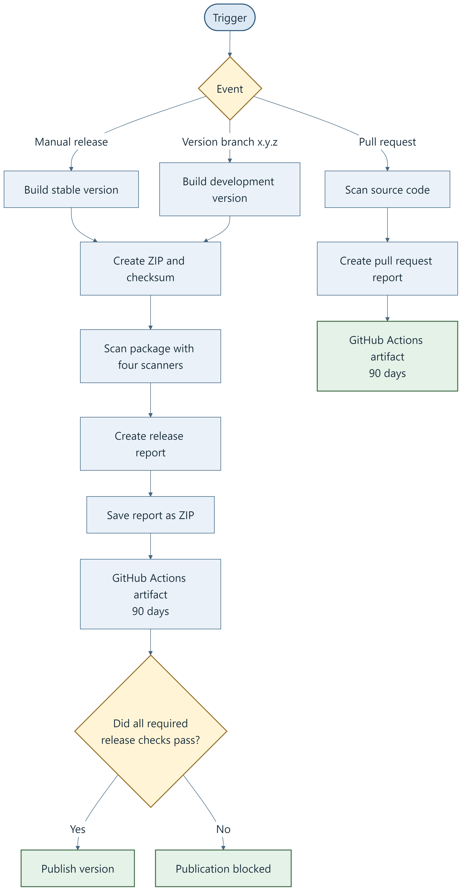
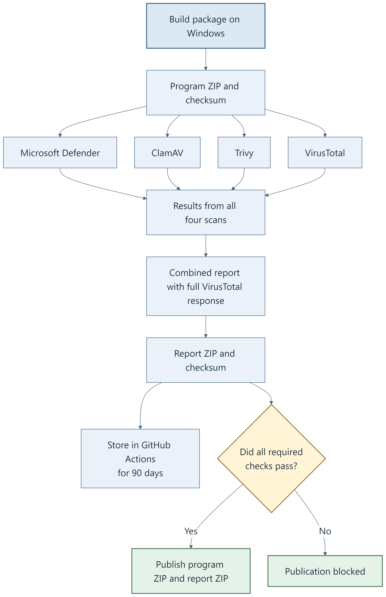
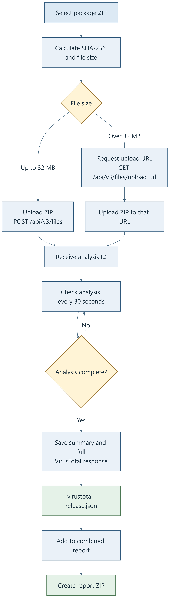

# Security Policy and Release Assurance

**Last reviewed:** 21 October 2026

**Open case:** [Issue #15](https://github.com/bonsaibauer/shroudforge/issues/15)

Security fixes target the latest stable release. Each case has its own table. The linked issue holds the discussion and dated updates.

## Case SF-SEC-15 — Issue #15

| Category | Status | Case record / action |
|---|---|---|
| CASE | **OPEN** | [Issue #15](https://github.com/bonsaibauer/shroudforge/issues/15) · Opened 19 Oct 2026, 19:17 UTC · Updated 21 Oct 2026 |
| RELEASE | — | <code>v1.7.0-build.39026384728</code> · ZIP SHA-256: <code>08a0c173b6c124e8057e9e0c8d146f7bcfc8f8814455119d06ee24efae975dca</code> |
| DETECTION | Reported | Defender reportedly flags <code>dinput8.dll</code> on game launch, not during extraction. SHA-256: <code>aa377a9ef07e87afdad5ce44059c5790bd265fbdb5fe83c987f9d7b98f0c20c5</code>. Name changed from <code>Trojan:Win32/Bearfoos.A!ml</code> to <code>Trojan:Win32/Kepavll!rfn</code>. |
| EVIDENCE | Scans differ by file | Supplied ZIP snapshot: 0/66 detections ([VirusTotal](https://www.virustotal.com/gui/file/08a0c173b6c124e8057e9e0c8d146f7bcfc8f8814455119d06ee24efae975dca)). Separate <code>kfc-runtime.dll</code> result: Cynet 1/71, score 100 ([VirusTotal](https://www.virustotal.com/gui/file/d51e47f40e093799748e4d31b4eb0ddb668a189731c5e260885323d5942fafa0)). |
| ASSESSMENT | Unresolved | No available result confirms infection or active compromise. A behavior-based false positive is plausible, but not confirmed by Microsoft or Cynet. The Cynet result concerns a different DLL from the Defender report. |
| UPDATE | ✅ Done | The four Defender attachments were reviewed and the maintainer checked the release files locally with Defender. No warning was reproduced. |
| TODO | ⏳ Awaiting response | Microsoft false-positive review submitted. Add the vendor's verdict here. |
| TODO | ⏳ Awaiting response | Cynet asked to review <code>kfc-runtime.dll</code>. Add its response here. |
| TODO | ⏳ Awaiting decision | SignPath open-source signing application submitted. No approval or certificate is confirmed. |

<!-- Case template. Copy this complete section only when a new case exists.
## Case SF-SEC-XX — Issue #XX

| Category | Status | Case record / action |
|---|---|---|
| CASE | **OPEN** | [Issue #XX](https://github.com/bonsaibauer/shroudforge/issues/XX) · Opened YYYY-MM-DD · Updated YYYY-MM-DD |
| RELEASE | — | Version/build · artifact hashes |
| FINDING | Reported | Affected file, reported behavior, and detection name |
| EVIDENCE | Recorded | Separate results by file and link to reports |
| ASSESSMENT | Open | Evidence-supported assessment and unresolved points |
| UPDATE | ✅ Done | Completed investigation step |
| TODO | ⏳ Pending | Next verification or vendor follow-up |
-->

## Release scanning

The workflows run a Trivy source scan for every event. Manual releases and version-branch pushes also build and scan the release ZIP. A pull request gets source checks only.

| Event | Workflow | Checks and publication |
|---|---|---|
| Manual release | [.github/workflows/build.yml](.github/workflows/build.yml) | Source scan, build, package scans, report. Publish a stable release if required jobs pass. |
| Push to a version branch such as 1.2.3 | [.github/workflows/dev_build.yml](.github/workflows/dev_build.yml) | Source scan, build, package scans, report. Publish a dev prerelease if required jobs pass. |
| Pull request | [.github/workflows/dev_build.yml](.github/workflows/dev_build.yml) | Source scan only. No release ZIP is built or published. |

The Windows build creates the ZIP and checksum. Defender, ClamAV, Trivy release scanning, and VirusTotal scan that run's artifact. The unified report records scanner results and job outcomes, including failed or skipped jobs. It does not claim an overall security verdict. Publication is blocked if a required job fails.

| Scanner | Scope | Release gate |
|---|---|---|
| Trivy source | Vulnerabilities, secrets, and misconfiguration in the repository and dependencies. Trivy is not a malware scanner. | Findings are reported. Findings alone do not block publication. |
| Microsoft Defender | Release ZIP and extracted contents in a unique temporary directory. | A detection, scan failure, or missing report blocks. Signature update failure is a warning and scanning continues with installed signatures. |
| Trivy release | Extracted release files. | Findings are reported through SARIF and JSON. Findings alone do not block. |
| ClamAV | ZIP and extracted files, after signature update. | Detection, scan failure, or signature update failure blocks publication. |
| VirusTotal | Each run-specific release ZIP, scanned as a whole. | Malicious result or scan/report error blocks. Suspicious-only result is a warning. |

The current [Defender scanner](dev/build/scan_release_with_defender.ps1) matches threat records by the unique scan directory and original ZIP path, independent of detection time. This is intended to include real-time detections recorded during extraction. The historical 1.7.0 workflow filtered by detection time after extraction. That gap could have hidden an earlier event, but the old job log does not prove that it did.

## VirusTotal

The [VirusTotal scanner](dev/build/scan_release_with_virustotal.sh) calculates the ZIP's SHA-256, uploads it through API v3, and polls the analysis every 30 seconds for up to 20 minutes. ZIPs over 32 MB use VirusTotal's large-file upload URL. The report stores the summary and complete final API response.

The job scans the ZIP as a whole. It does not upload each DLL separately or request VirusTotal's behavior endpoint. A clean ZIP result does not override a separate DLL detection or a runtime alert. The public API upload may add release files to VirusTotal's shared dataset. The API key is stored in the GitHub Actions secret <code>VT_API_KEY</code> and is not written to reports.

## Reports and retention

The report scripts are [write_release_security_report.py](dev/build/write_release_security_report.py) and [package_release_security_report.py](dev/build/package_release_security_report.py).

- Scanner artifacts used to pass results between jobs are retained for one day.
- The combined GitHub Actions report artifact is retained for 90 days.
- When a release is published, its report ZIP and checksum are attached as release assets. The 90-day Actions-artifact expiry does not remove those release assets.

## Reporting a security issue

Report suspected vulnerabilities privately. If private reporting is enabled, use [GitHub's vulnerability reporting form](https://github.com/bonsaibauer/shroudforge/security/advisories/new). Otherwise, contact the maintainers through their GitHub profile. Include the affected version, environment, and reproduction steps. Give maintainers time to investigate before publishing technical details.
