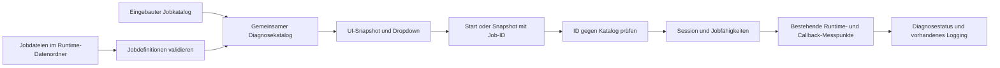

# Konzept: Runtime-Diagnostics mit Diagnosejobs

## Ziel

Runtime-Diagnostics soll in der Bedienung aus benannten, auswählbaren Diagnosejobs bestehen. Ein Job bündelt einen konkreten Messumfang. Die Einstellungen zeigen verfügbare Jobs in einem Dropdown, und die vorhandenen Start-, Stopp- und Snapshot-Aktionen führen den ausgewählten Job aus. Eigene Jobdefinitionen im ShroudForge-Installationsordner sollen nach einer Aktualisierung der Ansicht automatisch erscheinen.

Das Ziel ist eine klarere fachliche Gliederung. Es ist keine vollständige Neuimplementierung der Messungen und kein allgemeines Skript- oder Plugin-System.

## Geprüfter Ist-Zustand vor der Umsetzung

`modules/runtime-diagnostics/` ist bereits in einzelne Aktionen aufgeteilt. Die Session wird in `create_diagnostic_session.rs` erzeugt, liest die Konfiguration in `refresh_session_settings.rs`, verarbeitet sie in `tick_diagnostic_session.rs` und veröffentlicht ihren Status über `publish_diagnostic_status.rs`. Snapshot-Erfassung liegt in `capture_runtime_snapshot.rs`. Die UI ist in `ui/show-diagnostics.tsx`.

Die auswählbare fachliche Einheit ist momentan kein Job. `modules.runtimeDiagnostics.areas` enthält die Messbereiche `runtime`, `queue` und `mods`. `capture_runtime_snapshot.rs` steuert damit die Bereiche des KFC-Runtime-Snapshots. `modules/mod-runtime/ingame/update_ingame_runtime.rs` nutzt die Auswahl für Runtime-Metriken und Mod-Callbacks. `measure_runtime_operations.rs` sammelt Laufzeitmessungen für native und Lua-Operationen. Diese Operationsmessungen werden zurzeit aktiviert, sobald `runtime` oder `mods` aktiv ist. Ein eigener Job nur für Operationszeiten braucht daher eine explizite Aktivierungsfähigkeit.

Die Konfiguration liegt in `shroudforge/config/modloader-config.json`. `request_diagnostic_action.rs` schreibt Start, Stopp oder Snapshot und erhöht für Startaktionen `requestId`. Die laufende Session übernimmt Änderungen alle 500 Millisekunden. Laufzeit, Abtastintervall, Schwellenwert, Änderungsfilter und Messbereiche sind in `modules/loader-config/loader.schema.json` begrenzt. Der Status wird über das bestehende Zustandsdokument gespeichert. Die Modloader-UI liest ihn als `diagnostics`-Snapshot.

Die Profilablage ist ein gutes Muster für die Erkennung von Dateien, aber nicht für die Bedeutung der Dateien. Profile sind geprüfte Laufzeitdaten für native Spielstrukturen. `runtime_profiles_dir` löst sie unter dem konfigurierten Runtime-Datenpfad auf. `read_runtime_profiles.rs` sucht dort rekursiv nach JSON-Dateien und liest deren Kennungen. Jobdefinitionen brauchen zusätzlich eine eigene Validierung und eine begrenzte Bedeutung.

## Bewertung

Ein Dropdown passt, wenn es klar benannte Aufgaben auswählt, zum Beispiel „Runtime- und Mod-Überblick“, „Native ECS-Aufrufe messen“ oder „Warteschlange beobachten“. Nutzer müssen dann nicht wissen, welche Kombination aus drei internen Bereichsnamen den gesuchten Befund liefert.

Ein Ordner für Diagnosejobs passt als fachliche Gliederung und als Ablage für Jobdefinitionen. Er löst aber nicht von selbst die automatische Registrierung von Rust-Code. Der Modloader wird als Programm ausgeliefert und kann keine beliebigen Rust-Dateien aus dem Spielordner kompilieren oder sicher ausführen. Deshalb müssen eigene Dateien Daten beschreiben, die das ausgelieferte Diagnosemodul versteht. Neue Messarten benötigen weiterhin eine Implementierung im Quellcode und einen Eintrag in der eingebauten Jobregistrierung.

Die Aufteilung sollte nicht allein Dateien verschieben. `capture_runtime_snapshot.rs` und `measure_runtime_operations.rs` haben erkennbare Aufgaben. Der größere Entwurf liegt derzeit eher in der Kopplung zwischen Bereichsauswahl, Session-Lebenszyklus, Messinstrumentierung und UI. Ein Jobkatalog mit begrenzten Fähigkeiten schafft hier eine echte Zuständigkeitsgrenze.

## Vorgeschlagene Struktur

```text
modules/runtime-diagnostics/
  diagnostics-jobs/
    catalog.rs                 # Eingebaute Jobs und Auflösung ihrer Fähigkeiten
    runtime_health.rs          # Runtime- und Mod-Überblick
    queue_health.rs            # Warteschlangen- und Dispatcher-Beobachtung
    native_operation_timings.rs # Native Laufzeitmessungen
    definition.rs              # Geprüftes Modell für installierte Jobdefinitionen
  discover_diagnostic_jobs.rs  # Eingebaute und installierte Jobs zusammenführen
  run_diagnostic_job.rs        # Ausgewählten Job in einer Session ausführen
  ...                          # Vorhandene Session- und Statusaktionen bleiben
```

Die Dateinamen sind ein Vorschlag, keine Aufforderung, für jede kleine Funktion eine neue Datei anzulegen. Die konkrete Aufteilung sollte während der Umsetzung an den tatsächlichen Handlern und Abhängigkeiten ausgerichtet werden. Die fachliche Implementierung eines Messverfahrens gehört in `diagnostics-jobs/`. Session, Startanforderungen, Taktung und Status bleiben dem übergeordneten Diagnosemodul zugeordnet.

Es gibt einen eingebauten Katalog mit stabilen Kennungen. Jeder Eintrag benennt die zugelassenen Messfähigkeiten und verweist auf deren Implementierung. Ein Job führt nur Fähigkeiten aus, die in diesem Katalog existieren. So bleibt die Geschäftslogik an einer Stelle und die Auswahl dupliziert keine Messimplementierung.

## Ablage nutzerdefinierter Jobs

Der Standardpfad sollte unter dem vorhandenen Runtime-Datenpfad liegen:

```text
shroudforge/runtime/diagnostics/jobs/*.json
```

Die kanonische Pfadauflösung verwendet `shroudforge_loader_config::paths::runtime_dir(root)`. Damit folgt die Jobablage der bereits konfigurierbaren Runtime-Datenablage. Bei geändertem Speicherort muss die tatsächliche Ablage daher nicht unter `shroudforge/runtime` liegen. Der Pfad sollte in der UI angezeigt und über eine Aktion geöffnet werden, wie es die vorhandenen Storage-Einstellungen für andere Ablagen tun.

Jede JSON-Datei beschreibt genau einen Job. Das Modell sollte mindestens stabile Kennung, Anzeigename, Beschreibung, Version und eine Liste unterstützter Messfähigkeiten enthalten. Die Kennung ist unabhängig vom Dateinamen. Eingebaute IDs sind reserviert. Doppelte IDs und nicht unterstützte Fähigkeiten werden abgewiesen.

Der Loader scannt diesen Ordner beim Aufbau des UI-Snapshots oder bei einer gezielten Aktualisierung. Gültige Definitionen erscheinen danach ohne Codeänderung im Dropdown. Fehlerhafte Dateien dürfen die übrigen Jobs nicht blockieren. Die Oberfläche sollte den fehlerhaften Eintrag samt Dateipfad und Grund sichtbar machen, damit eine ungültige Definition nicht still verschwindet.

Nutzerdefinierte JSON-Dateien dürfen vorhandene Messfähigkeiten auswählen und deren unterstützte Parameter setzen. Sie führen keine Lua-, PowerShell-, Shell-, DLL- oder sonstigen ausführbaren Inhalte aus. Wer eine neue Messart braucht, ergänzt zunächst den Modulcode und registriert die Fähigkeit. Die JSON-Definition kann diese Fähigkeit anschließend benennen.

## Einstellungen und Ausführung

Die Modloader-Einstellungen zeigen einen Job-Dropdown, eine kurze Beschreibung des ausgewählten Jobs sowie die vorhandenen Aktionen Start, Stopp und Snapshot. Jobbezogene Dauer oder Intervall erscheinen nur, wenn der ausgewählte Job diese Optionen unterstützt. Globale Felder ohne Bedeutung für einen Job werden ausgeblendet.

Das Speichern der Auswahl und das Ausführen sind zwei getrennte Abläufe. Die UI sendet beim Start die Job-ID mit der Diagnoseanforderung. `requestId` bleibt erhalten, damit ein erneuter Start einer bereits laufenden Session weiterhin eindeutig ist. Stopp beendet die aktive Session unabhängig von der aktuell im Dropdown markierten Auswahl.

Das Dropdown wird aus einem UI-Snapshot-Feld mit Job-ID, Name, Beschreibung und Verfügbarkeit befüllt. Ein Befehl darf keine beliebige ID ungeprüft in die Konfiguration schreiben. `request_diagnostic_action.rs` muss die ID gegen den aufgelösten Katalog prüfen. Die CLI sollte dieselbe Prüfung und dieselbe Jobausführung verwenden, beispielsweise über `--job <id> --start` und `--job <id> --snapshot`.

Der Status sollte um die aktive Job-ID und, falls erforderlich, einen Job-spezifischen Bericht ergänzt werden. Bestehende Felder wie `active`, `reason`, `remainingSeconds`, `lastSampleAt` und `report` bleiben während einer Übergangsphase erhalten. Das Statusschema wird nur erweitert, soweit die UI die neuen Angaben wirklich verwendet.

## Umgang mit bisherigen Einstellungen

Die Umsetzung entfernt `areas` aus dem aktuellen Schema und aus der UI. Beim Laden einer älteren Konfiguration wird dieses Feld verworfen. `jobId` erhält den Standardjob `runtime.overview`, sofern keine Job-ID gespeichert ist. Eigene alte Bereichskombinationen werden nicht weitergeführt.

## Datenfluss



## Umsetzungsfolge

1. Den bestehenden Messumfang in konkrete eingebaute Jobs und Fähigkeiten abbilden. Zunächst nur vorhandene Bereiche und Messpunkte verwenden.
2. Katalogmodell, Kennungen und Validierung definieren. Eingebaute Jobs und nutzerdefinierte Definitionen erhalten denselben aufgelösten Typ.
3. Runtime-Pfad und Jobdateien mit `runtime_dir(root)` auflösen. Schemafehler, doppelte Kennungen und ungültige Fähigkeiten isoliert melden.
4. Startanforderung, CLI und UI um die validierte Job-ID erweitern. Vorhandene Fristen, Statusgründe, Request-IDs und Messgrenzen erhalten.
5. UI-Snapshot und Dropdown anbinden. Beschreibung, Verfügbarkeit und Fehler lokaler Definitionen sichtbar machen.
6. Alte Bereichsauswahl verlustfrei abbilden. Erst danach nicht mehr benötigte Einstellungsfelder entfernen.
7. Die fachlichen Collector-Dateien nach konkreten Messverantwortungen aus `capture_runtime_snapshot.rs` und den Session-Aufrufern trennen. Keine bloße Verschiebung ohne klare Handlergrenze.

## Geprüfte Aufrufer und Grenzen

- `modules/mod-runtime/ingame/start_ingame_runtime.rs` erzeugt die Session für den laufenden Spielprozess.
- `modules/mod-runtime/ingame/update_ingame_runtime.rs`, `modules/mod-runtime/ingame/load_runtime_callbacks.rs` und `modules/mod-runtime/ingame/stop_ingame_runtime.rs` führen Loader-Messungen an tatsächlichen Mod-Lebenszyklusstellen aus.
- `modules/game-runtime/bridge/` zeichnet native Operationszeiten über `diagnostics_jobs::operation_timings::span` auf.
- `modules/modloader/ui/host/request_diagnostics.rs` nimmt UI-Aktionen entgegen. `parse_ui_command.rs` und `read_ui_snapshot.rs` verbinden diese mit dem Modloader.
- `modules/loader-config/resolve_installation_paths.rs` besitzt die kanonische Auflösung des Runtime-Datenordners. `modules/modloader/ui/host/read_runtime_profiles.rs` zeigt das bestehende Muster für dateibasierte dynamische Einträge.
- `modules/entrypoints/loader/process_modes.rs` registriert den bestehenden Diagnose-CLI-Einstieg. `run_diagnostic_command.rs` verarbeitet aktuell Start, Stopp, Snapshot und Status.

Die Messungen bleiben zeitlich begrenzt und opt-in. Die Diagnosejobs lesen keine beliebigen Spielspeicherbereiche und erhalten keine zusätzliche Schreibberechtigung. Jobs ändern weder Laufzeitprofile noch native Kompatibilitätsentscheidungen. Client und Server verwenden weiterhin dieselbe Diagnoselogik und ihre jeweiligen vorhandenen Status- und Logpfade.

## Empfehlung und Umsetzung

Die Job-Idee ist als benannte, validierte Zusammenstellung vorhandener Messfähigkeiten umgesetzt. Eingebaute Messlogik und der Katalog liegen unter `modules/runtime-diagnostics/diagnostics-jobs/`. Eigene JSON-Definitionen werden aus `runtime_dir(root)/diagnostics/jobs/` eingelesen und automatisch im UI-Snapshot bereitgestellt.

Die UI enthält ein Dropdown, die Jobbeschreibung, den aktiven Job, den Jobordner und Fehler zu ungültigen Definitionen. Start und Snapshot senden die Job-ID mit der vorhandenen Request-ID-Logik. Der Laufzeitprozess führt den Job in seiner bestehenden Session im Hintergrund aus und hält die bisherige Zeitbegrenzung ein. Alte Bereichsauswahlen und ihre Übergangsjoblogik wurden entfernt.

Jobdateien fügen Daten und Parameter hinzu, aber keinen ausführbaren Rust-Collector. Eine neue Messfähigkeit wird im Quellcode unter `diagnostics-jobs/` implementiert und in `catalog.rs` registriert.
