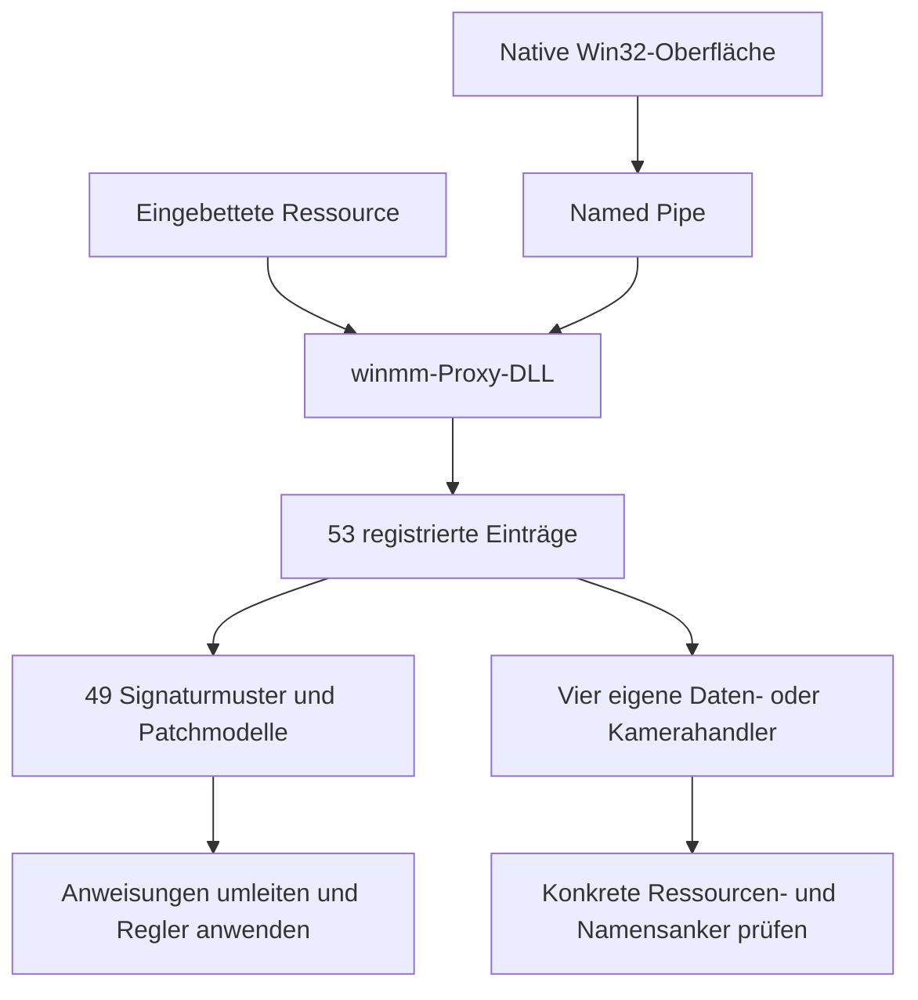

# Embervale Toolkit 3.1.0 und die KFC4-Runtime

## Ergebnis

Die lokale Anwendung enthält eine native Mod-DLL als Ressource. Deren Initialisierung registriert 53 Einträge. 49 davon besitzen kompilierte Signaturmuster. Die übrigen vier besitzen eigene Daten- oder Kamerahandler. Die Anwendung verwendet Signatursuche, Code-Caves und konkrete Ressourcenanker. Eine vollständig aufgelöste allgemeine ECS-Runtime ist durch diese Untersuchung nicht nachgewiesen.

Für die Gleiterfunktionen konnten Signatur, Ersatzanweisungen, Reglerrechnung, ursprüngliche Spielanweisungen und wesentliche Berechnungen miteinander verbunden werden. Dazu war keine vollständige Wiederherstellung des ursprünglichen C++-Quelltexts erforderlich. Die Semantik wurde aus den ausgeführten Maschinenanweisungen und den KFC4-Feldlayouts rekonstruiert.

## Identität und Untersuchungsumfang

| Objekt | Befund |
| --- | --- |
| Quelldatei | `A:\17 Cloud\OneDrive\Downloads\embervale-toolkit\EmbervaleToolkit.exe` |
| EXE SHA256 | `faba01e367f097e5181d8ead136e867f9a04396500bf5d6c4c94fb5eb827a0bf` |
| Enthaltene Mod-DLL | Ressource `10/300/1033`, 2.226.776 Bytes |
| DLL SHA256 | `f3521708762136cf9af76642b55c26a604b94ab7f31efd94468d4d2e12e3fc0a` |
| Architektur | Native x64-PE-Dateien, keine .NET-Assembly |
| Panel | 3.196 Unwind-Bereiche, 332.638 dekodierte Anweisungen |
| Mod-DLL | 1.424 Unwind-Bereiche, 98.259 dekodierte Anweisungen |
| Spiel | Steam-Build 25966634, KFC4, Version 1267041 |
| Spiel SHA256 | `4d6d43ea4a91e71c82d60b045dde932179c99e32e40657efe374688b2933589a` |

Die Panel-Bereiche umfassen 1.308.444 Bytes. Davon wurden 1.307.544 Bytes dekodiert. Die Disassemblierung ist deshalb ausdrücklich keine vollständige semantische Dekompilierung aller Funktionen. Blattfunktionen und eingebetteter Code können außerhalb der Unwind-Bereiche liegen. Die vertiefte Kontrollflussanalyse betrifft die Modregistrierung, Gleiterberechnung und ausgewählte Datenhandler.

Die Toolkit-EXE und ihre DLL wurden nicht nativ gestartet, installiert oder ins Spiel geladen. Die Konstruktorinitialisierung lief ausschließlich in privaten Unicorn-Speicherseiten mit begrenzter Instruktionszahl. Ein emuliertes `memset` schreibt nur in diese privaten Seiten. Es gibt keine Weiterleitung an Betriebssystem-APIs. Der Konstruktor kehrte regulär zurück.

## Aufbau



Die Pipe heißt `\\.\pipe\EnshroudedBuildingCompanion`. Die Bibliothek enthält eine Registrierungstabelle ab DLL-RVA `0x212370`, mit Datensatzgröße `0xa38` und maximal 64 Einträgen. Der Konstruktor beginnt bei `0x3a1b0`. 20 Einträge werden über die einfache Registrierungsroutine `0x4e70` angelegt, 29 über die Code-Cave-Routine `0x5050`. Vier Einträge entstehen über eigene Handlerarten.

Die Bibliothek enthält Prüfungen für mehrdeutige Signaturen, zu große Cave-Payloads, geänderte Originalanweisungen und belegte Patchstellen. Weitere Meldungen und Anweisungen rekonstruieren konkrete Stackslots, Zugriffskontexte und Transaktionshelfer für Teleport, Flugmodus und Inventaraktionen. Diese Befunde erklären die Toolkit-Implementierung. Sie belegen weder eine allgemeine native Funktionssignatur noch die Notwendigkeit, diese Eingriffe für ShroudForge zu übernehmen.

### Die vier gesonderten Handler

| Funktion | Tatsächlich beobachteter Zugriff |
| --- | --- |
| Enemy Level | Namensanker von `TemplateResource`, deren Komponenten-BlobVariant mit qualifiziertem Level-Hash und Größe geprüft wird. Geschrieben wird `Level.dataStorage[1]` in der Vorlage. |
| Terraform Radius | 39 feste GUID-Anker im Speicher. Dahinter wird ein Radius auf `Reglerwert/10` gesetzt. In alternativen Fällen werden fünf Terraforming-Schadenswerte auf 5000 gesetzt. |
| Prop Swapper (Live) | GUID-Anker und Referenz-GUID werden im Speicher gesucht. Referenzen in einem begrenzten räumlichen Bereich werden durch die gewählte GUID ersetzt. |
| Cinematic Camera | IAT-Hook von `GetRawInputData` mit Glättung der Mausdeltas. Eine KFC- oder ECS-Kamerakomponente wird dabei nicht verwendet. |

Die Level-Komponententabelle besteht aus zwölf Byte großen BlobVariant-Einträgen. Der Helfer prüft den Typ `keen::ecs::Level` über `qualifiedHash=0xe550da37` und Größe 16. Sein Schreibzeiger liegt acht Byte hinter dem Payloadanfang und entspricht dadurch `dataStorage[1]`, nicht `rootId`. Die Relative-Offset-Rechnung entspricht dem bestehenden Parsercodec. Ein EntityManager oder ein Archetype-Speicher wird dadurch nicht erschlossen. Details: [helper-mechanisms-analysis.de.md](helper-mechanisms-analysis.de.md).

## Alle registrierten Signaturen im aktuellen Spiel

Die statische Suche über die ausführbaren Spielsektionen ergibt für 49 Einträge:

| Ergebnis | Anzahl |
| --- | ---: |
| Ein eindeutiger Bytefolgetreffer | 45 |
| Zwei Treffer | 3 |
| Kein Treffer | 1 |

Die drei mehrdeutigen Einträge heißen `No Enemy Damage`, `One-Shot Enemies + Objects` und `Damage Multiplier`. Sie verwenden dasselbe Muster, das an RVAs `0x21be03` und `0x3e7df3` trifft. Das Toolkit besitzt zusätzliche Auswahlmechanismen. Diese Rohsuche allein beweist ihre Auswahl und Wirkung nicht. `Prop Swapper` trifft mit seinem registrierten Muster nicht im untersuchten aktuellen Spiel. Daraus folgt nicht, dass sein gesonderter Live-Handler fehlt.

Die zwei Treffer wurden bis zum Prozedurende verfolgt. Ihre Prozeduren `0x21bda0` und `0x3e7d90` sind jeweils 340 Byte groß und besitzen denselben Anweisungsablauf und dieselben direkten Helferziele. Sie lesen einen Attributheader mit `rootId`, `storageOffset`, Flags und `storageCount`, addieren einen 32-Bit-Wert in einen ausgewählten Speichereintrag und werten danach zugehörige Berechnungsprogramme aus. Ein fester Health-Typ oder eine Spieler-Entity wird in diesem Ablauf nicht geprüft. Diese Bytefolge identifiziert deshalb einen generischen Attribut-Änderungspfad. Ein zusätzlicher Treffer ist hier keine hinreichende Begründung, willkürlich eine Funktion als „die Schadensfunktion“ auszuwählen.

Beide Addierer rufen für die Berechnung `0x21c510` mit Ergebnisbuffer, Wertespan, Programmbefehlsspan und einem Nullparameter auf. Die direkte Analyse dieses Helfers zeigt vorzeichenbehaftete Division `cdq/idiv` bei `0x21c907/0x21c908` sowie vorzeichenbehaftete Min-/Max-/Clamp-Vergleiche. Er ist damit ein Signed-Interpreterkandidat. Die anderen zwei aktuellen Interpreter sind noch nicht zugeordnet. Die Anweisungen beider Addierer stehen in `ambiguous-damage-functions.json`.

**Die Result-Struktur hat sich gegenüber der Annahme des alten Offline-Prüfers geändert.** Der aktuelle Signed-Kandidat schreibt den Erfolgstag nach `Result+0`, ein weiteres Feld nach `Result+4` und den berechneten Wert nach `Result+8`. Der vorhandene alte Oracle liest den Ergebniswert hingegen bei `+4`. Das bloße Ergänzen einer neuen Interpreter-RVA würde daher falsche Ergebnisvergleiche erzeugen. Der KFC4-Oracle benötigt einen belegten Rückgabevertrag und frische Programme. Der aktuelle Runtime-Profilentwurf erhält dadurch keine Freigabe für `attributeCalculationModel`.

Die vollständige Tabelle einschließlich aller 53 Namen, Bytefolgen, Cave-Payloads und Rohparameter steht in `complete-registration-catalog.json`. Die Suche steht in `toolkit-signature-scan.json`.

## Gleiterregler und ursprüngliche Felder

Alle fünf untersuchten Gleiter-Signaturen treffen jeweils eindeutig.

| Toolkit-Regler | Spiel-RVA | KFC4-Feld im passenden ItemInfo-Layout |
| --- | --- | --- |
| Glider Move Speed | `0x42b6d0` | `equipment.gliderConfig.accelerationForward`, Offset `0x4c0` |
| Glider Lift Speed | `0x42b8fb` | `equipment.gliderConfig.airResistanceLongitudinal`, Offset `0x4c4` |
| Glider Descend Speed | `0x42b886` | `equipment.gliderConfig.airResistanceVertical`, Offset `0x4cc` |
| Glider Turn Speed | `0x26ae36` | `equipment.gliderConfig.yawAngleSpeed`, Offset `0x4d0` |
| Infinite Flying | `0x26ae0e` | Geladene Codekonstante, kein entsprechendes Feld belegt |

Der Inlinepfad ist `ItemInfo.equipment @0x104` plus `EquipmentSetup.gliderConfig @0x3bc`. Die acht Gleiterfelder sind Float32. Das DS-Layout beginnt dagegen erst bei `0x650`. Interne Hashes sind teilweise gleich, obwohl diese Layouts verschieden sind. Der detaillierte Vergleich steht in [glider-reflection-analysis.de.md](glider-reflection-analysis.de.md).

Die Bezeichnungen „Move Speed“, „Lift Speed“ und „Descend Speed“ dürfen nicht als ursprüngliche Feldnamen oder direkte physikalische Geschwindigkeiten übernommen werden.

### Reglerrechnung im Toolkit

Die vier Cave-Payloads laden den ursprünglichen Spielwert und multiplizieren ihn mit:

```text
Faktor = max(float(Reglerwert) * 0.01f, 0.25f)
geladenerWert = ursprünglicherWert * Faktor
```

Die Float32-Konstanten sind `0A D7 23 3C` und `00 00 80 3E`. Die Turn-Cave benutzt XMM4. Die drei anderen Caves sichern XMM3, rechnen damit und stellen XMM3 wieder her. Die Datensätze enthalten zusätzlich Reglergrenzen und Anfangswerte. Die Skalierung wirkt an der jeweiligen Leseanweisung. Sie berechnet keine vollständige Flugbewegung außerhalb des Spiels.

### Herkunft der Basiszeiger

In der Prozedur ab Spiel-RVA `0x42b0e0` entsteht R12 durch den Rückgabewert von `0xe7a250` bei `0x42b1e8`. In `actor_rotation`, Prozedur `0x269d30`, entsteht RDI durch denselben Helfer bei `0x26a834`. Zwischen diesen Rückgaben und den vier relevanten Feldzugriffen bleibt der jeweilige Basiszeiger erhalten.

Der Helfer `0xe7a250` erhält einen UInt32-Schlüssel in ECX und einen Servicezeiger in RDX. Für Schlüssel null liefert er null. Ansonsten sucht er im Teilobjekt `Service+0x38` über `0xe6c570` und liefert den Pointer aus dem gefundenen Wertslot. Der zweite Helfer verwendet Belegungsbits, eine Kapazitätsmaske, UInt32-Schlüsselvergleich und lineares Weitersuchen. Diese Datenflussverbindung ist aus den Anweisungen belegt.

Die endgültige Typ- und Lebensdauerprüfung dieses internen Serviceobjekts ist noch offen. Aus einem passenden Offset und einem gemeinsamen Lookup folgt allein noch keine allgemeine Berechtigung, solche Pointer außerhalb der laufenden Enginephase zu verwenden.

### Winkeländerung

Bei `0x26ae36` wird der passende `yawAngleSpeed`-Wert geladen. Er wird bei `0x26ae4b` mit `0.01745329238474369f`, also dem Float32-Wert für Grad nach Radiant, und bei `0x26ae59` mit dem Frame-Zeitschritt multipliziert. Der Zeitschritt stammt an dieser Stelle aus dem bei `RBP+0x1688` gespeicherten, von Nanosekunden umgerechneten Wert.

Für endliche, nicht negative Geschwindigkeitsparameter ist der lokale Yaw-Schritt damit sinngemäß:

```text
maxSchritt = yawAngleSpeed * (pi / 180) * dt
schritt = clamp(zielYaw - bisherigesYaw, -maxSchritt, maxSchritt)
neuesYaw = bisherigesYaw + schritt
```

Die anschließende Winkelbehandlung enthält zusätzliche Umbrüche an `2*pi`. Pitch und Roll verwenden an den RVAs `0x26aeae` und `0x26af01` die Nachbarfelder `+0x4d4` und `+0x4d8` mit derselben Umrechnung und Schrittbegrenzung. Das ist die lokale Winkelrechnung, keine vollständige Rekonstruktion aller 4.576 Anweisungen von `actor_rotation`.

### Zeitschritte und Vorwärtsbeschleunigung

Die Prozedur `0x42b0e0` rechnet einen Zeitwert mit der Double-Konstante `1e-9` in Sekunden um. Bei `0x42b5ec` wird durch `0xfe502b * 1e-9`, also ungefähr `1/60` Sekunde, geteilt. Der blattförmige Helfer `0x2454c0` rundet positive Werte durch Addition von `0.5` und Abschneiden. Die Anzahl der Teilschritte wird auf 1 bis 32 begrenzt. Danach wird der Zeitschritt durch diese Anzahl geteilt.

Am Anfang jedes Teilschritts wird `accelerationForward` geladen. Der Code bei `0x42b6d0` bis `0x42b72d` berechnet für die drei Richtungsanteile jeweils:

```text
deltaV[i] = accelerationForward * richtung[i] / referenzSchritt
            * teilSchritt * stromFaktor * aktivierungsFaktor
```

Hier ist `referenzSchritt` der oben genannte 60-Hz-Referenzwert. `stromFaktor` wird unmittelbar vorher als `1 - DynamicLocomotion.gliderUpstreamUpwardsFactor * 0.55f` berechnet. Der Aktivierungsfaktor wird im vorherigen Kontrollfluss aus einer Zeitdifferenz auf den Bereich 0 bis 1 begrenzt. Die Zuordnung seiner vollständigen fachlichen Bedeutung wird nicht als bewiesen behauptet. Der berechnete Beschleunigungsanteil wird zur eingelesenen Geschwindigkeit addiert, bevor die Widerstandszerlegung erfolgt.

### Tatsächliche Widerstandsrechnung

Die drei Widerstandsrichtungen benutzen denselben Helfer ab `0xe5d190`. Er erhält Ergebnisbuffer, Vektor, Koeffizient und Teilschritt. Für endliche Eingaben und Vektorlänge oberhalb `1e-20` berechnet er:

```text
laenge2 = x*x + y*y + z*z
laenge = sqrt(laenge2)
verlust = min(1.0f, laenge2 * koeffizient * teilSchritt / laenge)
ergebnis = vektor * (1.0f - verlust)
```

Für nicht negative Koeffizienten ist das algebraisch `vektor * max(0, 1 - laenge * koeffizient * teilSchritt)`. Die angegebene erste Form erhält die beobachtete Anweisungsreihenfolge. Bei hinreichend kleiner Länge liefert der Helfer den Nullvektor. Besondere NaN-, Overflow- oder negative Parameterfälle sind mit dieser Zusammenfassung nicht allgemein freigegeben.

Die Aufrufe liegen bei `0x42b877` für `airResistanceLateral`, `0x42b8c4` für `airResistanceVertical` und `0x42b912` für `airResistanceLongitudinal`. Zuvor werden Geschwindigkeitsanteile über Projektionen getrennt. Danach werden die drei gedämpften Vektoren wieder addiert. Deshalb ist eine lineare Regleränderung des Widerstands keine lineare Änderung der Endgeschwindigkeit.

Vier private Offline-Emulationen des originalen Spielhelfers bestätigen die rekonstruierten lokalen Rechenschritte. Beispielsweise werden `(3,4,0)`, Koeffizient `0.2` und Schritt `0.1` zu ungefähr `(2.7,3.6,0)`. Ein großer Widerstandsverlust liefert null. Bei Koeffizient null bleibt der Vektor erhalten. Das ist kein Test einer geladenen Spielwelt. Ergebnisse: `drag-helper-emulation.json`.

### Infinite Flying

Das ursprüngliche `movss` bei `0x26ae0e` lädt `0.0872664600610733f`, also ungefähr fünf Grad in Radiant. Die Toolkit-Cave ersetzt diesen geladenen Wert durch `-1.5700000524520874f`, ungefähr minus 90 Grad. Der folgende Code verwendet den Wert in seiner Auswahl und Begrenzung des Zielwinkels. Die benachbarte obere Konstante beträgt ungefähr 80 Grad.

Dieser Eingriff ändert eine Codekonstante. Die ItemInfo-Felder `pitchAngleSpeed` und `yawAngleSpeed` steuern Änderungsgeschwindigkeiten. Sie sind kein belegter Ersatz für diese Winkelgrenze. Eine Migration von Unlimited Flight auf eines dieser Felder wäre derzeit semantisch unbegründet.

Aus diesem Toolkit-Eingriff folgt nicht, dass Infinite Flying grundsätzlich einen Codepatch benötigt. Ein gleichwertiger Weg über reguläre Enginezustände oder deren Eingaben ist weiterhin unbewiesen. Die geforderte Lösung muss ohne Änderung ausführbaren Spielcodes auskommen.

## Konsequenzen für ShroudForge

1. Typnamen, Feldnamen, Vererbung und Layouts kommen weiterhin aus dem aktiven KFC-Parser.
2. Runtime- und Vorlagentypen werden über die tatsächlichen Engine-Registrierungsbeziehungen unterschieden. Interne Hashes und gleiche Größen allein genügen nicht.
3. Die vorhandene Ressourcen-API bearbeitet KFC-Dateikopien. Sie besitzt noch keine Verbindung von Item-ID oder Ressourcen-GUID zum geladenen `ItemInfo`, das die Gleiterberechnung tatsächlich liest. Die reflektierten Gleiterfelder sind deshalb noch keine funktionierenden Live-Regler.
4. Die ergänzten `runtime.ecs.read_fields` und `write_fields` verwenden Parser-Typen und können Inlinefelder auswählen. Sie benötigen weiterhin einen gültigen Entity-Speicher und die bisherige, über Codehooks betriebene Ausführung. Sie liefern weder den fehlenden Ressourcenbesitzer noch einen nachgewiesenen Gameplayeffekt.
5. Alle 721 gefundenen Engine-Systemdeskriptoren werden im vorhandenen Funktionskatalog mit ihren 2.804 Typabhängigkeiten verknüpft. Das ist keine Liste von nur 21 Profiloperationen.
6. Das Nutzerziel ist eine gemeinsame dynamische API ohne Änderungen am ausführbaren Spielcode. Dafür fehlen weiterhin die unabhängige Kontextauflösung, Lebensdauerverträge und eine zulässige Ausführungsphase. Zusätzliche Patchadapter oder das bloße Verschieben ihrer Signaturen in Profile erfüllen dieses Ziel nicht.

Die Änderungen erzeugen keine zweite Toolkit-Runtime. Die fremde DLL und ihre Code-Caves werden nicht eingebaut. Der bisherige Profilentwurf bleibt deaktiviert. Ein durchgängiger, in der geladenen KFC4-Welt bewiesener Entity-Lese-/Schreibpfad und alle nativen Gameplay-Signaturen sind weiterhin offen.

### Konkrete Datei-/Laufzeitlücke

`ResourceInfo::get_mapped_value` in `api/src/env/app_state.rs` liest über den KFC-Reader und hält eine Parser-/Lua-Kopie. Der Commit in `api/src/lib.rs` schreibt diese Kopie über `KFCWriter` auf Datenträger. Die Ingame-API wird mit `patch: false` gestartet. In diesen Pfaden existiert kein geladener Ressourcenresolver und keine Aktualisierung von Engine-Verbrauchern.

Der frühere [Schmelzenbefund](../runtime/2026-10-09-smelter-production.de.md) dokumentiert die tatsächliche Abweichung. Die Datei enthielt eine Sekunde Rezeptdauer, zwei validierte laufende `RecipeInfo`-Datensätze dagegen 600 Sekunden. Die damaligen Startprobleme wurden im Quellcode korrigiert. Ein neuer Wirkungsnachweis für KFC4 liegt damit noch nicht vor.

Auch `GameThreadDispatcher` besitzt keine originale Keen-CommandQueue. Seine eigene Jobliste wird über installierte Codehooks abgearbeitet. Der nächste ungelöste Vertrag ist daher die Kette von aktiver Item-/Ressourcenidentität über den geladenen Besitzer zum tatsächlich konsumierten Objekt einschließlich Lebensdauer und zulässiger Änderung. Ein Build oder ein vollständiger Metadatenkatalog ersetzt diesen Nachweis nicht.

## Artefakte

- [Registrierungskonstruktor reproduzieren](../runtime/source-evidence/embervale-toolkit-3.1.0/capture-constructor.py.txt)
- `complete-registration-catalog.json` · Alle 53 Registrierungen
- `toolkit-signature-scan.json` · Alle 49 Signaturmuster im aktuellen Spiel
- [Reflektierte Gleiterfelder und Mehrdeutigkeiten](glider-reflection-analysis.de.md)
- [Die vier Daten- und Kamerahandler](helper-mechanisms-analysis.de.md)
- `game-glider-instructions.json` · Originale Spielanweisungen der Gleiterprozeduren
- `signed-attribute-interpreter-candidate.json` · Signed-Interpreterkandidat mit neuem Ergebnislayout
- `drag-helper-emulation.json` · Widerstandshelfer in privater Emulation
- `enshrouded-client-25966634-kfc4/resolved-system-dependencies.json` · Vollständige Systemabhängigkeitsauflösung mit dem echten Rust-Resolver

## KI-Codex-Check

| Prüfung | Ergebnis |
| --- | --- |
| Ziel | Struktur, Berechnung und mögliche Einordnung in die vorhandene API untersucht. |
| Belege | Lokale PE-Dateien, eingebettete Ressource, Originalanweisungen und aktuelle Parserlayouts. |
| Struktur | Untersuchung in ignoriertem Devdata, produktive Typauflösung im bestehenden Runtimekatalog. |
| Dateicheck | PE-Bereiche automatisiert disassembliert, genannte Rechenwege und Handler gezielt analysiert. Kein vollständiger semantischer Quellcodeaudit behauptet. |
| Prüfung | Native Runtime und Rust-API gebaut. Konstruktor und Widerstandshelfer ausschließlich privat emuliert. |
| Offen | Gesamte native Semantik, endgültige Service-Typprüfung, echte Entityzugriffe und Gameplaywirkung im laufenden Spiel. |
