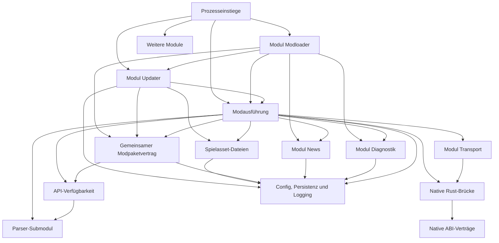

# Repository-Analyse und Neuorganisation

Dieser Bericht dokumentiert den damaligen Struktur- und Auditstand. Die anschließende Reduzierung mit aktuellen Dateinamen, Löschungen und Prüfungen steht im [Reduzierungsbericht](reduction-report.md). Prüfsummen und Pfadlisten dieser Strukturphase sind historische Momentaufnahmen.

Stand: 17. Oktober 2026. Ausgangsstand: Commit `81f9c5f`. Audit und beschlossener Strukturplan. Der aktuelle Umsetzungsstand und die ausgeführten Prüfungen stehen im [Umsetzungsbericht](refactor-implementation.md). Aussagen zum Ausgangsbestand beziehen sich weiterhin auf `81f9c5f`.

**Alle 287 eigenen Codedateien mit 85.865 physischen Zeilen wurden vollständig gelesen.** Die Einzeldateianalyse beschreibt Aufgaben, Aufrufer, Datenflüsse, Seiteneffekte, vorhandenen Testschutz und Verschieberisiken. Daraus folgen die vorgeschlagenen Verantwortungsgrenzen.

Die wichtigste Änderung ist die Verlagerung von Geschäftslogik aus dem UI-Backend und dem Updater in ihre tatsächlichen Besitzer. Umbenennen allein löst das Problem nicht. Die neue Struktur soll anschließend diese Besitzer sichtbar machen.

## A. Repository-Bestandsaufnahme

### Umfang und Nachweis

| Bestand | Ergebnis |

| --- | --- |

| Getrackter Ausgangsbestand im Hauptrepository | 1.040 Pfade einschließlich zweier Submodule-Gitlinks |

| Eigene manuell gepflegte Codedateien | 287 von 287 vollständig gelesen, 100 % |

| Physische Zeilen dieser Dateien | 85.865, einschließlich Kommentare, Leerzeilen und ausführbarer Testfixtures |

| Externe Parserkomponente | 243 Blattdateien, davon 169 codeförmig |

| Externe JSON-Bibliothek | 1.163 Blattdateien, davon 487 codeförmig einschließlich Dokumentationsbeispielen und Testhilfen |

| Zusätzliche vollständige Lektüre relevanter Abhängigkeitsverträge | Startbrücke sowie 9 Parservertrags-/Exportdateien, separat im Abdeckungsnachweis |

| Generierte codeförmige Dateien im Hauptrepository | 4, separat vom eigenen Implementierungsumfang |

| Codeänderungen durch dieses Audit | Keine |

| Tests, Builds und Spieleläufe | Nicht ausgeführt |

Nach der ausdrücklich bestätigten Eingrenzung bleiben Fremdbibliotheken beim getrennten Inventar. Ihre individuellen Implementierungen werden hier nicht als vollständig geprüft dargestellt. Binäre EML-Sidecars haben keinen zugänglichen Quellcode in diesem Auditumfang. Aus Kommentaren über diese DLLs wird keine Funktion als bewiesen übernommen.

Der [Abdeckungsnachweis](refactor-audit-coverage.md) nennt Nenner, Erzeugnisse, Ausschlüsse und Prüfmethoden. Die [Hauptinventarliste](refactor-file-inventory.csv) enthält jede der 1.040 Positionen. Das [Abhängigkeitsinventar](refactor-dependency-inventory.csv) enthält die 1.406 externen Blattdateien. Lokale ignorierte Build-, Cache- und Installationsausgaben sind kein weiterer manuell gepflegter Quellbestand.

### Tatsächlich vorhandene technische Einheiten

Das Produkt verbindet Windows-DLL-Start, eine Rust-Anwendung mit mehreren Prozessmodi, Lua-Modausführung, KFC-Dateiverarbeitung, einen nativen Live-Provider, mehrere eingebettete Weboberflächen und eine separat gebaute Dokumentationswebsite. Rust, C++, Lua, TypeScript/JavaScript, Python und PowerShell haben jeweils konkrete Aufgaben. Sie sollten nicht in ein künstliches einheitliches Framework übersetzt werden.

`cargo metadata --no-deps --offline --locked --format-version 1` wurde erfolgreich ausgeführt. Das aufgelöste Workspace enthält **13 Pakete**. Dazu gehören auch `world-editor-ui` und die über eine Pfadabhängigkeit aufgenommene `mod-loader-bridge`. Eine bloße Lektüre der expliziten `members`-Liste hätte diese Bestandsaufnahme verfehlt. Im aufgelösten Cargo-Abhängigkeitsgraphen besteht kein Crate-Zyklus. Das schließt problematische Kopplungen über Dateien, Schemas, CLI-Aufrufe und DLL-Exporte nicht aus.

Das KFC-Backend wird über eine Git-Abhängigkeit mit Revision `a404b15cde40fc7bd43d812bb460ce40d2a9d3b1` verwendet. Der Parser-Submodule-Pin steht auf `34a156f6614f78c3340c07e4750afa400349abeb`. Beide dürfen nicht ungeprüft gleichgesetzt werden.

### Nachgewiesene Hauptabläufe

| Ablauf | Tatsächlicher Zusammenhang |

| --- | --- |

| Spielstart | Proxy/Bootstrap → Startfreigabe → Vorbereitung/Kindprozesse → nativer Runtime-Lifecycle und Rust-Mod-Lifecycle |

| Moderkennung | `ModRegistry::load_mod` berücksichtigt Verzeichnisse. Installierte Mods sind entpackte Pakete. |

| Assetvorbereitung | Modplan → Originalsicherung/Recovery → Parser und Lua-Assetänderungen → gemeinsame Veröffentlichung des Dateisatzes → Vorbereitungsnachweis |

| Runtime-Mods | Paketplan → Lua-Umgebung und Callbacks → Updates → geordnete Restaurierung/Entladung mit Rechte-, Session- und Verfügbarkeitsprüfung |

| Einstellung ändern | UI-/Control-Auftrag → Revision und Werte prüfen → `extended.mod.json` beziehungsweise Loaderkonfiguration speichern → Sicht und Runtime aktualisieren |

| EML ohne Erweiterung | `mod.json` bleibt gültig. Beim Speichern kann die fehlende Erweiterung mit erhaltener EML-Herkunft angelegt werden. |

| Systemupdate | Release prüfen → Download/Prüfsumme → Staging → gegebenenfalls Prozessende abwarten → verwaltete Dateien ersetzen → Backup/Rollback und Status |

| Kataloginstallation | Version wählen → Download prüfen → einmal entpacken → Modverzeichnis mit Runtime-Abstimmung und Rollback austauschen |

| Welteditor | Lua-Weltoperationen und P2P-Fachprotokoll plus verbundenes Desktop-Overlay für Bibliothek und Cover |

| Website | Annotationen/Schema/Snapshots → Generatoren/Artikelindex → veröffentlichte Daten → Browserdarstellung und Manifest-Autoreneditor |

Ein Autoren-ZIP der Website, ein heruntergeladenes Installationsarchiv und ein installierter Mod sind verschiedene Dinge. Aus den ersten beiden folgt kein ZIP-Modbetrieb. Der unterstützte laufende Betrieb verwendet entpackte Verzeichnisse.

## B. Einzeldateianalyse

Die vollständige Antwort auf „Was macht diese Datei und wofür ist sie da?“ steht im [Einzeldateianhang](refactor-source-audit.md). Er enthält **für jede der 287 Dateien alle 15 Prüffragen**, konkrete Symbole oder Quellbelege, SHA-256 und Zeilenzahl. Fehlende Test- oder Nutzungsnachweise sind markiert.

| Datei | Tatsächliche Aufgabe | Konsequenz |

| --- | --- | --- |

| `modloader-ui/src/main.rs`, 5.951 Zeilen | Fenster, IPC, Snapshot, Moddateien, Settings, EML-Erweiterung, Nachrichten, Kataloginstaller und Releaseprüfung | Geschäftslogik in Paket-, Installations-, Update- und Runtimebesitz überführen. Fenster und Darstellung bleiben beim UI. |

| `updater/src/main.rs`, 2.864 Zeilen | Release, Queue, Staging/Installation, Windowsworker, Config-Steuerung, Runtime-Aufträge und Spielasset-Restore | Gemeinsamen Updateablauf herstellen. Runtimekontrolle und Spielasset-Originale erhalten eigene Besitzer. |

| `api/src/env/loader.rs`, 4.257 Zeilen | Lua-Verfügbarkeit/Policy, ECS-/Weltbindings und nativer DLL-Adapter mit NichtWindows-Stubs | Lua-Bindungen und native Rust-Brücke trennen. Öffentliche Lua-Namen erhalten. |

| `api/src/lib.rs`, 1.503 Zeilen | API-Fassade, Assetausführung, Lifecycle, Reload, IPC, Diagnose und Netzwerkbeobachtung | Nach Ausführungsphase und Lebensdauer aufteilen. Cleanup- und Reloadbedingungen erhalten. |

| `package/src/config.rs`, 449 Zeilen | Atomisches JSON, Schemawahl, Statusabschnitte, Loaderdefaults, Pfade, Fensterwünsche und Settingsvalidierung | Gemeinsames Speichern klein halten. Konkrete Regeln ihren Besitzern zuordnen. |

| `parser/src/transaction.rs`, 211 Zeilen | Staging, Rollbackjournal, Commit und Wiederanlauf eines Spielasset-Dateisatzes | Zu Spielasset-Dateien verschieben. Keine Parserformatlogik. |

| `native/ecs/ecs_runtime.cpp`, 2.442 Zeilen | Registry, Handles, Queries, Feldänderungen, Propgeometrie und Delegation | Allgemeines ECS und konkrete Weltoperationen trennen. Besitzprüfungen erhalten. |

| `reference-mods-0.9/world-editor/src/mod.lua`, 3.321 Zeilen | Blueprintcodec, Bibliothek, Vorschau, Weltoperationen, Undo und Client-/Serverablauf | Nach realen Teilaufgaben zerlegen. Ordnername beweist keine Verwaisung. |

| `website/app.js`, 1.134 Zeilen | Routing, Markdown, Manifesteditor, eigene Regeln, Downloadpaket und Referenzsuche | Browsermodule trennen und Vertragsregeln mit Loaderquellen abgleichen. |

Die 2.448 Zeilen der Lua-Ganzzahldeklarationen sind hauptsächlich ein zusammenhängender Typvertrag. Auch die Debugkonsole hat eine erkennbare gemeinsame Aufgabe. Größe allein begründet keine Aufteilung.

## C. Neue Klassifikation

Die Kategorien entstehen aus Ressourcenbesitz, Datenflüssen und Änderungsgründen. Sie übernehmen nicht die bisherigen Sammelordner als verbindliche Architektur.

| Kategorie | Definition und Codebeispiele | Grenze |

| --- | --- | --- |

| Prozessstart und Anwendungskomposition | DLL-Einstieg, Startgate, CLI-/Worker-/Fenstermodi, Vorbereitungsreihenfolge | Keine Releaseauswahl oder Manifestregeln |

| Modpakete und Sollwerte | Manifeste, EML-Normalisierung, Aktivierung, Settings, Ziele, Abhängigkeiten, Modkonflikte | Keine Fenster, HTTP-Anfragen oder Spielasset-Originale |

| Loader-Support | Loaderkonfiguration, Pfade, atomische Persistenz und Logpipeline | Keine beliebigen Produktfunktionen wie Welteditor oder Katalog |

| Spielasset-Dateien | Originale, Fingerprints, persistente Assettransaktion und Recovery | Keine Live-Spielzeiger und keine Systemreleases |

| Modausführung | Lua-Umgebung, Modrechte, Asset-Modausführung, Callbacks, Reload und Restaurierung | Nutzt Parser und Live-Brücke, implementiert diese nicht erneut |

| KFC-Dateiformate und Reflection | Formatadapter, Typinformation, öffentliche Schema-/Snapshotprojektion | Keine Modverwaltung oder Live-Weltänderung |

| Live-Spielzugriff und Build-Kompatibilität | Native ABI, Besitz/Session, ECS, Ressourcen, Dienste, Welt, Buildprofile, geprüfte Patches | Definierte Zugriffspunkte für Lua/UI, unterschiedliche Engine-Sperrprotokolle erhalten |

| Softwareverteilung | Systemreleaseprüfung, Systeminstaller, Modkataloginstaller, Queue und Worker | Konkrete Installer behalten unterschiedliche Inhalte, Archive enden im Installationsablauf |

| Eingebaute Module | Modloader, Updater, Debugkonsole, Welteditor, Diagnostik, Nachrichten, Commands und Transport. Jedes besitzt seine Implementierung und vorhandene UI. | Gemeinsame Modulebene. Fachregeln und UI beim jeweiligen Besitzer. |

| Mods und Autorenpakete | `mods/` behält die beiden aktuellen Mods. EML-, Referenz- und Diagnosebestand bleiben in ihren bestehenden Verzeichnissen. | Keine zusätzlichen Kategorien oder Paketverschiebungen |

| Entwicklung und Veröffentlichung | Profilgewinnung, Emulator-/Fixtureprüfungen, Builds, Websitegeneratoren und Daten | Kein Produktlaufzeitcode allein aufgrund gemeinsamen Speicherorts |

Tests gehören zum geschützten Verhalten. Ressourcen und Schemas folgen ihrem Verbraucher oder Vertrag. Fremdkomponenten bleiben versionierte Abhängigkeiten.

## D. Architekturvergleich

| Modell | Eignung anhand des Codes | Entscheidung |

| --- | --- | --- |

| Rein technische Schichten | Verteilen Einstellungen, Updates und Welteditor über globale controllers/services/repositories. Konkrete Ressourcen- und Prozessgrenzen erklären mehr. | Als Gesamtordnung ungeeignet |

| Strikte Domänenarchitektur | Pakete, Vorbereitung und Verteilung sind gute Grenzen. ABI, Binärlayouts und Enginephasen passen nicht in eine zusätzliche universelle Geschäftsmodellhierarchie. | Zuständigkeiten übernehmen, zusätzliches Abstraktionssystem vermeiden |

| Vollständige hexagonale Architektur | Sinnvoll an HTTP, Dateien und Providergrenze. Interfaces für jede Hilfsoperation würden mehr Code erzeugen. | Konkrete Grenzen kapseln, kein flächiges Portframework |

| Ausschließlich Package-by-Feature | Gut für Welteditor, Debugkonsole und UI. Parser, Logpipeline, Modvertrag und Enginebesitz haben mehrere Verbraucher. | Für Produktfunktionen verwenden, Vertragsbesitzer ergänzen |

| Interne Pluginplattform | Lua-Mods und Native-Mod-DLLs sind vorhandene Erweiterungen. Daraus folgt kein Bedarf für dynamische interne Updater-/Fensterplugins. | Vorhandene Erweiterungen erhalten, keinen zusätzlichen Pluginhost einführen |

| Getrennte Dienste | Windows-Dateisperren erklären Worker, aber keine neue verteilte Dienstlandschaft. | Technisch notwendige Prozessgrenzen erhalten |

| Modularer Monolith mit fachlichen Funktionen und technischen Vertragsgrenzen | Gemeinsame Auslieferung, mehrere erforderliche Binärziele, Modvertrag sowie Parser-/Native-Grenzen passen zusammen. | **Empfohlen.** Kleine Module, direkte Aufrufe, wenige notwendige Worker |

Teamgröße und Reviewverteilung sind unbekannt. Der Entwurf setzt kein großes Team voraus. Er nutzt bestehende Sprachen und Buildsysteme. Neue Abstraktionen benötigen konkrete Mehrfachverbraucher oder eine technische Grenze.

## E. Vorgeschlagene Zielarchitektur

### Eine gemeinsame Modulebene

**Modloader, Updater, Debugkonsole, Welteditor, Diagnostik, Nachrichten, Commands und Transport sind Module auf derselben Ebene. Jede vorhandene Oberfläche gehört vollständig zu ihrem Modul.**

Die vorherige Aufteilung in einen übergeordneten `modloader/`-Baum, globale `ui/`, `features/` und einen separaten Transportzweig ist verworfen. Sie hätte denselben Modulbegriff unterschiedlich abgebildet.

```text

entrypoints/

  loader/                          # CLI, C-ABI und Prozesszusammensetzung

  windows-bootstrap/               # Proxy, Startgate und frühe Lifecycle-Anbindung

support/                           # vorhandene gemeinsame Verantwortung beibehalten

  config/

  storage/

  control/

  logging.rs

  paths.rs

packages/                          # Paketvertrag, Ordnerdiscovery, Settings, Modplan

game-assets/                       # Originale, Fingerprints, Commit und Recovery

execution/                         # Lua-Host, Assetausführung, Lifecycle und Cleanup

modules/

  modloader/

    lib.rs                         # öffentliche Moduloperationen

    ui/                            # eigene Fenster-/IPC- und Webquellen

  updater/

    lib.rs

    system-updates/                # Releaseprüfung, Staging und Systeminstallation

    mod-installation/              # Katalog und entpacktes Modpaket installieren

    queue/

    windows/

    ui/                            # eigener UI-Teil

  debug-console/

    lib.rs

    ui/

  world-editor/

    lib.rs

    ui/

  runtime-diagnostics/

    lib.rs

    ui/

  news/

    ui/

  commands/

    lib.rs

  transport/

    lib.rs

    lua/

    native/

  ui-resources/

    tokens.css

    window_icon.rs

kfc-parser/                        # direkt das Git-Submodul

  Cargo.toml

  crates/

    kfc-base/                      # Container, Reflection, Registry und Formathelfer

    kfc-resource/                  # vorhandene Ressourcenwerte und Codecs

    kfc-content/                   # vorhandene konkrete Inhaltsformate

    kfc/

      src/                         # vorhandene Innenstruktur des Submoduls

        lib.rs

        schema.rs                  # geplanter Export der vorhandenen Schemaprojektion

        snapshot.rs                # geplanter JSON-/Lua-Snapshotexport

    mod-loader-bridge/

    ...                            # übriger vorhandener Submodulbestand

kfc-runtime/

  bridge/                          # Rust-Anbindung der nativen C-ABI

  compatibility/

  native/

    abi/

    host/

    engine-context/

    execution/

    ecs/

    loaded-resources/

    named-services/

    voxels/

    building/

    player-input/

    code-inventory/

    patches/

    profiles/

    json/                          # JSON-Submodul beim nativen Verbraucher

  profiles/

  tests/

mods/                              # ausschließlich die beiden vorhandenen Mods

  sf-survival/

  sf-unlimited-flight/

eml-mods/                          # vorhandener Ort bleibt erhalten

reference-mods-0.9/                 # vorhandener Ort bleibt erhalten

diagnostic-mods/                    # vorhandener Ort bleibt erhalten

tools/runtime-profiles/

tools/inspection/

examples/runtime/

templates/mod/

website/

docs/

assets/

build.ps1

```

`modules/modloader/` ist ein Modul auf derselben Ebene wie die anderen Module. Sein eigener UI-Teil liegt darunter. Die Verantwortungen Support, Pakete, Spielassets und Ausführung bleiben erhalten. Es wird keine zusätzliche `core/`-Sammelebene eingeführt.

Der Zielbaum enthält keine zusätzlich dazwischengeschobenen `src/`-Ordner. Für die Umsetzung werden die konkreten Quelldateipfade in den jeweiligen Buildmanifesten angegeben. Die bereits vorhandene innere Struktur des Parser- und JSON-Submoduls bleibt erhalten. Auch vorhandene Mod-Einstiege wie `src/mod.lua` werden dadurch nicht umbenannt.

Ein Modul mit eigener Oberfläche besitzt deren Fenster-/IPC-Code und Webquellen in seinem `ui/`-Teil. Bereits vorhandene Gliederung wird nur nach tatsächlicher Aufgabe weiter aufgeteilt.

Diagnose- und Nachrichtenansichten, die im Modloader-Menü erscheinen, bleiben Quellcode ihres jeweiligen Moduls. Das Modloader-Menü setzt deren öffentliche Ansichten oder Aufträge zusammen. Es kopiert weder Messregeln noch Nachrichtenlogik. Gemeinsame Tokens und Icondekodierung sind ein kleines Ressourcenmodul, kein gemeinsamer Fensterdienst. Die heute getrennten WebView2-Profile bleiben erhalten.

### Bestehenden Modbestand erhalten

`mods/` enthält aktuell `sf-survival` und `sf-unlimited-flight`. Dieser Bestand bleibt erhalten. Es werden keine zusätzlichen Kategorieordner angelegt und keine EML-, Referenz-, Export- oder Diagnosemods aus ihren bestehenden Verzeichnissen hineingeschoben.

`eml-mods/`, `reference-mods-0.9/` und `diagnostic-mods/` bleiben an ihren bisherigen Orten. Die Welteditor-Mod bleibt deshalb unter `reference-mods-0.9/world-editor/`. Das eingebaute Welteditor-Hostmodul erhält seinen eigenen Modul- und UI-Teil. Der Refactor ändert keine Releaseaufnahme von Mods.

### Parser direkt im Parserprojekt

Formathelfer, Reflection, öffentliche Schemaprojektion und Snapshotexport gehören direkt nach `kfc-parser/`. Die zusätzliche Parserhülle entfällt. `kfc-parser/` selbst ist der Submodule-Einhängepunkt. Parserintegration wird direkt in diesem Projekt ergänzt.

| Heute | Vorgeschlagener Besitzer und Ziel |

| --- | --- |

| `src/parser/src/lib.rs::kfc_format` | Vorhandenes `kfc-base`, beispielsweise `container/resource_lookup.rs` |

| Typ-/Feld-/Enumprojektion und `schema_from_registry` | Vorhandenes `kfc`, neu `src/schema.rs` |

| `src/parser/src/snapshot.rs` | Vorhandenes `kfc`, neu `src/snapshot.rs` |

| `GameFiles::client/server` und Erkennung des Spielprozesses | Loader-Einstieg wählt Dateinamen und übergibt allgemeine Dateipfade an den Parser |

| `transaction.rs`, Originale und Recovery | `game-assets/`, da Staging und Veröffentlichung dem Loader gehören |

| Parserstatus, Modplanung und Spielstart | Jeweiliger Loaderablauf, der ein Parserergebnis verwendet |

Die benannten Schema-/Snapshotdateien sind **geplante Änderungen im Parser-Submodul**, keine bereits vorhandenen Dateien. Vorhandene Reflection-Serialisierung und Legacyexporte sind keine unveränderten Ersatzimplementierungen des aktuellen Snapshotvertrags. Dessen `profile.json`, `types.json`, `resources.json` und `types.lua` bleiben zunächst erhalten. Zusätzliche Crates für diese wenigen Dateien sind nicht nötig.

Aktuell verwenden die Cargo-Abhängigkeiten `kfc` aus Revision `a404b15c`, während das lokale Submodul auf `34a156f6` steht. Ein gezielter lokaler Vergleich zeigt 14 betroffene Parser-/Testdateien, 939 Ergänzungen und 143 Löschungen. **Eine bewusst gewählte Submodulrevision wird die gemeinsame Parserquelle.** Dazu werden Parserexporte im Parserprojekt ergänzt, alle Verbraucher auf diesen Checkout umgestellt und anschließend der eigene Adapter abgelöst. Das ist mehr als eine Pfadänderung. In diesem Entwurf wurden weder Submodulquellen noch Pins verändert.

### Runtime nach tatsächlichem Datenbesitz

Der heutige API-Sammelname `runtime.world.*` beschreibt keine einheitliche Engine-Datenkategorie. Die Implementierung erhält deshalb präzisere Besitzer. Bestehende öffentliche Lua-Namen können zunächst unverändert auf diese Besitzer registriert werden.

| Kategorie | Tatsächlicher Gegenstand | Heutige Lua-Aufrufe | Implementierungsgrenze |

| --- | --- | --- | --- |

| `ecs/registry` | Originale Komponentenregistrierungen und reflektierte Runtime-/Templaterollen | `runtime.ecs.get_registry`, `get_catalog`, `get_component` | Registry/Reflection abgleichen |

| `ecs/entities` und `ecs/queries` | Entity-Manager, IDs, Generation, Mitgliedschaft, räumliche Auswahl | `runtime.ecs.resolve`, `query`, `query_bounds` | Entityidentität und Abfrage |

| `ecs/components` | Konkreter Komponentenspeicher mit reflektiertem Layout | `runtime.ecs.read*`, `write*` | Begrenztes Lesen und CAS unter den originalen Guards |

| `ecs/attributes` | Von `keen::ecs::AttributeComponent` abgeleitete Werte und Definitionen aus Attributressourcen | `runtime.ecs.*attribute*` | Lua/Resolver für Definition und Berechnung, nativer Zugriff über Komponenten |

| `ecs/templates` | Entity-Relation zu `keen::ecs::TemplateResource` | `runtime.ecs.get_template*` | Entityrelation hier, gemeinsame Ressourcendaten beim Ressourcenspeicher |

| `ecs/props` | `keen::ecs::CurrentTransform`, `keen::ecs::UsedItem`, Item-ID und Template-UUID | `runtime.world.entity.query_props*`, `get_transform`, `set_scale`, `register_prop_recipes` | Spezialisierte ECS-Sicht, bereits heute im ECS-Code implementiert |

| `loaded-resources` | Geladene KFC-Payloads unter `ResourceService`/`KfcResourceContent`, GUID + Typ + Part | `game.assets.get_loaded*`, `read_loaded_field`, `write_loaded_field` | Eigenes Lebensdauer-/CAS-Protokoll und originale ItemRegistry-Relation |

| `named-services` | Originale benannte DI-Daten wie `keen::ecs::GameSettings` | `runtime.services.get` | Szenengebundene Servicedaten, trotz Namenspräfix keine ECS-Komponente |

| `voxels` | Zellen mit Material/Dichte, CellSpan, Gitter und Dimensionen | `runtime.world.voxel.*`, `get_grid_spec` | Konkretes Voxelgitter mit eigenem Kontext |

| `building` | Originale Prop-Erzeugung, Place-/Remove-Queues und Bauereignisse | `runtime.world.entity.spawn`, `place`, `destroy`, `finish_building` | Bauoperation und Wirkungsprüfung |

| `player-input` | `keen::ecs::ClientPlayerInput` und Snapshot des Baucursors | `runtime.world.building.*`, `runtime.world.cursor.get` | Tatsächlicher Clienteingabepfad. Ausgelöstes Input ist keine bestätigte replizierte Bauwirkung. |

| `engine-context` | Scene, Autorität, Sitzung, Besitzer und Lebensdauer | `runtime.world.session_id` | Gemeinsame Besitzprüfung. `context_active` und `context_kind` prüfen dagegen die Voxel-/Client-Cursorwelt beim spezifischen Besitzer. |

| `code-inventory` | Reflektierte/inventarisierte Codebelege | `runtime.functions.*` | Beschreibung und geprüfte Bindungen, kein beliebiger nativer Call |

| `patches` | Profilgeprüfte Änderungen ausführbaren Codes | `runtime.patch.*` | Originalbytes, Aktivierung und Restaurierung |

Die Zuordnung wird auf der Lua-Seite sichtbar:

```text

execution/lua/runtime/

  mod.rs                         # bestehende öffentliche Namen registrieren

  policy.rs                      # Modrechte und Verfügbarkeitsentscheidung

  ecs/

    registry.rs

    entities.rs

    components.rs

    queries.rs

    attributes.rs

    templates.rs

    props.rs

  loaded_resources.rs

  named_services.rs

  voxels.rs

  building.rs

  player_input/

    cursor.rs

    building.rs

  engine_context.rs

  code_inventory.rs

  patches.rs

execution/runtime/

  overrides.rs                     # modgebundene Tracker und Restaurierung

  ownership.rs                     # getrennte Claims für Komponenten, Ressourcen, Dienste

```

Die nativen Ordner verwenden dieselben fachlichen Kategorien. Eine Kategorie erzeugt nur dort eine Datei, wo tatsächlich eine Implementierung liegt. Beispielsweise nutzen die Lua-Attributberechnungen das bestehende native ECS-Lesen/CAS. Dafür wird kein fiktiver zweiter nativer Attributdienst angelegt.

Vorbereitete KFC-Dateiressourcen bleiben bei der Asset-/Parserintegration. Geladene Ressourcen besitzen dagegen den aktuellen Engine-Speicher. Eine `TemplateResource` ist gemeinsame Ressourcenkonfiguration, kein individueller Komponentenwert. Der tatsächliche vollqualifizierte Originaltyp der profilgefundenen Voxelwelt ist in den geprüften Implementierungen nicht eindeutig belegt. Die Struktur nennt daher die belegte Fähigkeit `voxels`, statt einen Originaltyp zu erfinden.

Konkrete Belege: `env/loader.rs` registriert ECS bei 516 und den heutigen Welt-Namensraum bei 538. Propzugriff liegt in `ecs_runtime.cpp` unter anderem bei 2081/2199/2260. `runtime_attributes.rs` bindet Attribute ein. `runtime_templates.rs` verbindet Entity und Template. `resource_runtime.cpp` besitzt den Live-Ressourcenpfad. `service_runtime.cpp` implementiert die benannten DI-Daten. `building_input.cpp` arbeitet auf ClientPlayerInput. `world_runtime.cpp` enthält heute die zu trennenden Voxel-, Bau- und Cursorpfade.

### Öffentliche Verträge und erlaubte Abhängigkeiten

Module verwenden die öffentlichen Operationen und Ergebnisdaten anderer Module. Private Fensterdateien, VM-Interna und native Besitzstrukturen werden nicht quer importiert. Der Modloader darf beispielsweise einen Updateauftrag stellen und dessen Ergebnis anzeigen. Die Releasewahl bleibt im Updatermodul. Nachrichten- und Diagnoseansichten bleiben bei ihren Modulen.



Der Komponentenentwurf ist zyklenfrei. Lua-Module erhalten einen begrenzten Kontext für Registrierung, Rechte und Nachrichten. Sie hängen dafür nicht vom vollständigen Ausführungshost ab. Die native Steam-Implementierung gehört zum Transportmodul und wird weiterhin in die bestehende Runtime-DLL gelinkt. C++-Hostzusammensetzung, Rust-Bibliotheksabhängigkeiten und öffentliche ABI-Verträge werden dabei getrennt geprüft.

### Einstellungen und Updatebesitz bleiben erhalten

`mod.json` bleibt die EML-Identität. `extended.mod.json` bleibt Quelle für Erweiterung, Aktivierung und Modsettings. Das vorhandene Schema unterstützt eine einfache Checkbox bereits direkt:

```json

{

  "schemaVersion": 1,

  "enabled": true,

  "settings": {

    "unlimitedFlying": {

      "value": true,

      "label": "Unlimited Flight",

      "description": "Fliege so lange du willst",

      "control": "checkbox"

    }

  }

}

```

Das ist ein Schema-Beispiel und keine behauptete Live-Spielprüfung. Bestehende EML-Textkonfigurationen bleiben ihr eigener Vertrag. Loaderoptionen stehen weiterhin in `shroudforge/config/modloader-config.json`. Runtimezustand und Statusprojektion bleiben vom gewünschten Einstellungsstand getrennt.

Der Speicherablauf bleibt: Auftrag mit Revision → aktuellen Stand lesen → Änderung prüfen → atomar speichern → neue Revision zurückgeben → Runtime nach bestehender Regel aktualisieren → bestätigten Stand anzeigen. EML-Erweiterungserzeugung wird als `ensure_eml_extension` erhalten. Sie bleibt unabhängig vom einmaligen Entpacken beim Installieren.

Das Updatermodul besitzt eine Systemreleaseprüfung für Bootstrap, Desktop und headless. Systeminstallation und Modinstallation bleiben konkrete unterschiedliche Teilaufgaben unter diesem Modul. Seine eigene UI zeigt den gemeinsamen Zustand. Queue-/Stage-/Workerdateien werden weiterhin anhand realer Produzenten und Verbraucher konsolidiert.

## F. Vollständige Dateizuordnung

Die [Zuordnungstabelle mit 1.040 Zeilen](refactor-file-inventory.csv) enthält Istpfad, tatsächliche Rolle, Symbole, Aufrufer, Abhängigkeiten, Kategorie, Besitzer, Zielpfad, Maßnahme, Begründung, Risiko, Leseumfang und Evidenzstatus. Die Gitlink-Zeilen werden durch das [Abhängigkeitsinventar](refactor-dependency-inventory.csv) ergänzt. Zielpfade verwenden eine gemeinsame Modulebene und die beiden bestehenden Modpakete unter `mods/`.

Größen und Prüfsummen des Hauptinventars beziehen sich auf den Ausgangsbestand. Die neu verfassten Auditdokumente sind Ergebnisdateien. Die folgenden Kurzpfade zeigen Teilaufgaben, die CSV enthält die vollständigen vorgeschlagenen Zielpfade einschließlich Rust-Quellwurzeln.

Mehrere Zielpfade bedeuten Aufteilung. Ein gemeinsamer Zielpfad aus mehreren Quellzeilen bedeutet geplante Zusammenführung. Die Tabelle behauptet nicht, große Mischdateien ließen sich vollständig und gefahrlos verschieben.

| Istpfad oder Teilaufgabe | Ziel und Entscheidung | Begründung |

| --- | --- | --- |

| `package/src/registry/manifest_reader.rs` | Lesen, EML-Normalisierung, Settingsprojektion, API-Inferenz als interne Paketmodule | Verschiedene Inputs und Änderungsgründe |

| `update_mod_extension` im UI | `packages/manifest/ensure_eml_extension.rs`, `settings/update.rs` | Für entpackte EML-Pakete erforderlich |

| Releaseprüfungen in UI und Updater | Ein `modules/updater/system-updates/check.rs` | Gleicher Release-/Tag-/Build-/Prüfsummenablauf |

| `parser/src/transaction.rs` | `game-assets/transaction.rs` | Persistenter Dateisatz mit Recovery |

| Nativer Adapter in `env/loader.rs` | `kfc-runtime/bridge` | Mehrere API-/Transportverbraucher |

| Zwei Typgeneratoren | Im Parser-Submodul beziehungsweise beim Lua-Vertrag erhalten | Öffentlicher Snapshot und tatsächliche Lua-Typansicht unterscheiden sich |

| `value/mapped.rs`, `value/simple.rs` | Unterschiedliche Besitzansichten erhalten | Originalbytes/Lazy/Dirty gegenüber eigenen normalisierten Werten |

| Welteditorpaket | `reference-mods-0.9/world-editor`, nur intern gezielt zerlegen | UI-/API-/Testbeziehungen vorhanden |

| Profilentwicklungswerkzeuge | `tools/runtime-profiles`, native Fixtures zur Runtime | Entwicklung und Produktlaufzeit trennen |

| Schemakopien, Snapshotdaten, UI-dist | Erzeuger pflegen und Veröffentlichungs-/Einbettungspfad nachziehen | Keine konkurrierenden handgepflegten Quellen |

„Verschieben“ bedeutet bei generierten Dateien die Anpassung des Erzeuger-/Einbettungspfads und anschließende Neuerzeugung. Generierter Inhalt wird nicht manuell refaktoriert.

Es gibt keine pauschale Löschliste. Lokal nicht referenzierte Frontendhelper sind Prüfkandidaten. Dynamische Lua-/IPC-/CLI-Verwendung und externe Verweise verhindern eine belastbare globale Löschentscheidung allein anhand eines Suchtreffers.

## G. Architekturleitlinien

1. **Eine Fachoperation hat einen Besitzer.** UI, Bootstrap, CLI und headless sind Auslöser derselben Operation. Sie implementieren die Regeln nicht erneut.

2. **Dateinamen benennen die Aufgabe.** Beispiele sind `ensure_eml_extension`, `transaction`, `queries` und `reload`. Neue allgemeine `manager`, `service` oder `utils`-Sammlungen brauchen eine konkrete Begründung.

3. **Aufteilung folgt der Verantwortung.** Andere Ressourcen, Änderungsgründe oder Abhängigkeiten begründen eine neue Datei. Eine starre Zeilengrenze nicht.

4. **Private Details bleiben privat.** Lua-Namen, Native-ABI, Manifestversionen und Prozess-/Dateiaufträge sind Verträge. Ein interner Cache oder C++-Besitztyp wird dadurch keine öffentliche Schnittstelle.

5. **Ein Speicherweg, konkrete Validierung.** Atomisches JSON wird gemeinsam genutzt. Der Fachbesitzer prüft seine Daten. Darstellungsprojektionen besitzen keine zweiten Sollwerte.

6. **Archive gehören zum Paketbezug.** Ein Download kann entpackt werden. Discovery und laufende Ausführung verwenden Ordner. EML-Erweiterungserzeugung ist ein eigener Kompatibilitätsfall.

7. **Lebensdauer gehört zum Vertrag.** Sessionwechsel, Compare-and-Swap, Schreibbesitz, Cleanup, Enginephase, DLL-Freigabe und Rollback bleiben erhalten.

8. **Reine Berechnung bleibt rein.** Typauflösung, Feldplan, Attributberechnung und Codecvalidierung benötigen weder Fenster noch Prozesse oder eine universelle Serviceabstraktion.

9. **Tests folgen ihrem Verhalten.** Native Fixtures, Mod- und P2P-Szenarien bleiben mit ihren echten Quellen verbunden. Ein Mock beweist keine Live-Spielwirkung.

10. **Quelle und Erzeugnis sind erkennbar.** Schemakopien, Annotationsexporte, Snapshots und UI-Bündel haben dokumentierte Erzeuger.

11. **Prüfung und Release haben getrennte Auslöser.** Pull Requests müssen ohne Releasebedarf prüfbar sein. Der existierende Build-Einstieg bleibt auffindbar.

12. **Beiträge nennen Besitzer und Vertragswirkung.** Ein kurzer Moduleinstieg beschreibt Zweck, öffentliche Verträge, Abhängigkeiten und Prüfungen. CODEOWNERS kann reale Teamzuständigkeiten abbilden. Personen werden hier nicht erfunden.

Modloader ist ein Modul unter `modules/modloader`. Der UI-Teil jedes Moduls bleibt dort. `mods/` behält seine beiden aktuellen Modpakete. Andere Modverzeichnisse werden nicht zusammengeführt. Parserfunktionalität wird im Parser-Submodul gepflegt, gemeinsam verwendete technische Helfer bei ihrem tatsächlichen Verbraucher.

Cargo-Metadaten, gezielte Import-/Include-Prüfungen, Schema-/Generatorvergleiche und vorhandene Fixtures können diese Regeln kontrollieren. Dafür ist keine zusätzliche Architekturplattform notwendig. Neue öffentliche Änderungen brauchen einen nachvollziehbaren Vertrag und gegebenenfalls eine Migration. Interne Umzüge sollten keine neue öffentliche Versionslinie erzeugen.

## H. Technische Problemstellen

### H1. Vermischung und echte Duplikation

**Systemreleaseprüfung ist doppelt.** Im [UI-Backend](../../modules/modloader/ui/host/window.rs) ab `start_update_check` bei Zeile 5240 und `fetch_latest_github` bei 5600 sowie im [Updater](../../modules/updater/system-updates/check.rs) ab `headless_check_system_updates` bei 1720 wird derselbe fachliche Ablauf mit Tag-/Buildvergleich, Prüfsumme und `latestRelease`-Persistierung separat ausgeführt. Bereits geteilt sind Checkkoordination und Release-Notes-Parsing. UI-Konfiguration und headless fest verdrahtete Quelle können auseinanderlaufen. Maßnahme: eine Operation und ein Ergebnis, mehrere Aufrufer.

**Der Kataloginstaller liegt im Fensterbackend.** Der Updater startet ihn unter anderem bei Zeile 2526 über den Loader mit `--catalog-install-worker`. Das ist eine reale CLI-Kopplung. Maßnahme: Installer herauslösen, vorhandenen Worker-Einstieg zunächst kompatibel erhalten.

**Runtimekontrolle wird vom Updater besessen.** Headless-Konfigurationsverarbeitung und Runtime-Unload/Reload liegen in dessen Hauptdatei. `workflow/lib.rs` startet diesen Worker. Maßnahme: Runtime-Aufträge und Quittierung bei Modausführung/Anwendung ansiedeln. Updates nutzen nur den konkreten Auftrag.

**DLL-/Symbolanbindung ist mehrfach vorhanden.** `env/loader.rs`, `runtime_building.rs`, Steam-Transport und Diagnostik lösen native Exporte separat auf. Maßnahme: gemeinsame Rust-Brücke mit kanonischer ABI. Die Fachverträge für Bau, Netzwerk und Diagnose bleiben getrennt.

**Dispatcher und Patchbackend überlappen technisch.** Signatur-/Imageprüfung und nahe Speicherallokation haben gleiche Muster. Nur nachweislich gleiche Primitiven teilen. Hooklebensdauer, Patchinhalt und Weltcallbackverdrahtung bleiben konkrete unterschiedliche Aufgaben.

### H2. Pakete, Einstellungen und EML

Die [Registry](../../packages/manifest/mod.rs) überspringt Nichtverzeichnisse in `load_mod`. Zusätzliche Archiv-Lese-/Schreibzweige gibt es unter anderem in UI und Status. Diese werden als Widerspruch zum gewünschten Ordnerbetrieb isoliert behandelt. Die Installation benötigt weiterhin ZIP-Prüfung und Extraktion.

**Die EML-Erweiterung ist davon unabhängig.** Im [UI-Backend](../../modules/modloader/ui/host/window.rs) verwenden `save_mod_settings` bei 3370 und `set_mod_enabled` bei 3399 den Helfer `update_mod_extension` bei 3440. Er ergänzt eine fehlende Erweiterung mit `launcher: "EML"`, Aktivierung und Zielen, validiert Erweiterung und kombiniertes Manifest und schreibt beim Verzeichnisfall über `config::write_json`. Ihn als vermeintliche ZIP-Funktion zu entfernen würde einen bestehenden Kompatibilitätsablauf zerstören.

Der Manifestreader verbindet Dateizugriff, EML-Normalisierung, Settingsprojektion und rekursiv gelesene Lua-Textheuristik zur Phasenerkennung. Die Heuristik ist keine vollständige statische Lua-Analyse. Eine neue deklarative Phasenangabe wäre ein eigener Vertrags-/Kompatibilitätsschritt und keine Voraussetzung des Umbaus.

`ModEnvironment` nutzt bereits eine gemeinsame Graphfunktion für seine Pläne. Eine neue zweite Planengine wäre unbegründet. Teilweise werden Fehlerkategorien aus Texten gewonnen. Explizite Fehlergründe sind hier die kleinere Verbesserung.

### H3. Persistenz, Logs und wiederholte Arbeit

[config.rs](../../support/storage/json.rs) kompiliert Validatoren pro Validierung und enthält zugleich konkrete Fensteraufträge. [paths.rs](../../support/paths.rs) liest für konfigurierte Pfadauflösungen erneut Loaderkonfiguration. Auch direktes Loganhängen liest Konfiguration. Andere Pfade verwenden bereits einen kurzen Levelcache.

Maßnahmen: feste Validatoren wiederverwenden, einen Pfad-/Konfigurationskontext je Revision bilden und Logpolicy über einen nachvollziehbaren Aktualisierungsweg erneuern. Externe Konfigurationsänderungen müssen sichtbar bleiben. Weniger I/O ist aus dem Code ableitbar, ein gemessener Geschwindigkeitsgewinn wird nicht behauptet.

`package/src/log.rs` enthält Aufrufmakros und ist kein zweites Backend. C++-Frühstartlogging benötigt einen kleinen Adapter vor Verfügbarkeit des Rust-Loggers. Format und Levelbedeutung können gemeinsam geregelt werden. Der installationsübergreifend benannte Windows-Logmutex ist ein Prüfkandidat für parallel betriebene Installationen. Ein konkreter Konflikt wurde nicht reproduziert.

### H4. Runtime und Ressourcenbesitz

`IngameRuntime` baut bei Reload den Runtimezusammenhang neu auf. Eine Mod-ID-Liste bedeutet im gelesenen Ablauf keine beliebige partielle VM-Rekonstruktion. Bei ausstehendem Cleanup bleiben bestimmte Schreib-/Besitzkontexte absichtlich erhalten. Diese Regeln dürfen beim Vereinfachen nicht verschwinden.

`AppState` verbindet KFC-/Assettransaktion, Live-Ressourcensnapshots, CAS/Sessionbindung und native Mod-DLLs. Sie haben verschiedene Lebensdauern. Native Mod-DLLs werden in dessen `Drop` freigegeben. Eine Aussage, alle DLLs blieben generell bis Prozessende geladen, wäre falsch.

`ResourceLifeGuard` und ECS-Schreibwache schützen unterschiedliche originale Besitz-/Sperrketten. Sie sind keine austauschbaren Duplikate. Ressourcen-, Welt- und ECS-Dateien enthalten dagegen echte Teilaufgaben für interne Extraktionen. Vorhandene private Speicherfixtures helfen dabei, beweisen aber keine vollständige Spielintegration.

### H5. Konkrete statische Fehler und Vertragsdrift

| Befund | Codebeleg und mögliche Wirkung | Gezielte Folgearbeit |

| --- | --- | --- |

| Lua-Variable vor lokaler Definition | Welteditor `mod.lua` Zeile 1864 verwendet `#props`, Zeile 1865 definiert erst `local props = captured_props`. Im gelesenen Geltungsbereich fehlt eine vorherige Definition. Replace kann mit Nilfehler abbrechen. | Isolierter Fix mit Szenario für bereits erfasste Zielprops |

| Fehlender NichtWindows-Stub | `env/loader.rs` Zeilen 331 und 446 verwenden `world_entity_query_props_ready`. Es gibt die Windowsimplementierung, aber keinen entsprechenden NichtWindows-Stub. | Betroffenes Target prüfen und gezielt korrigieren |

| Fehlerhafte Modulsettings-Seiten | `seed-reference-pages.mjs` Zeile 522 behandelt eine bereits extrahierte properties-Map als Schema. Vorhandene Ausgabe `modloader-settings/modules-modules` enthält `/modules/modules`. | Ableitung und betroffene Artikel vergleichen/korrigieren |

| Defekter Schemaquelllink | Seeder Zeile 374 nennt `extended-mod.schema.json`, vorhanden ist `extended.mod.schema.json`. Erzeugte Artikel übernehmen den falschen Link. | Quelle und Ausgabe reparieren |

| Nicht registrierte API-Dokumentation | `Resource.original_data` ist als TODO deklariert, aber nicht als Lua-Feld registriert. `shroudforge.mod_kind` steht in Deklarationen, fehlt in `create`. | Vertragsstatus entscheiden und Generatordaten abgleichen |

| Callbacktyp als Objektpfad | Website-Alias `RuntimeLifecycle` → `runtime.lifecycle` erzeugt scheinbare Felder wie `runtime.lifecycle.on_load`. Tatsächlich enthält die Modrückgabetabelle die Callbacks, `runtime.lifecycle` ist eine Fähigkeitskennung. | Typ-/Callbackdokumentation von registrierten Objektpfaden unterscheiden |

| Releaseabhängige CI-Prüfung | `.github/workflows/build.yml` koppelt wesentliche Build-/Prüfjobs an den Releasevergleich. PRs ohne Releasebedarf bekommen dadurch nicht denselben Verifikationspfad. | Prüfung unabhängig von Veröffentlichung auslösen |

Diese Befunde sind statisch und teilweise an eingecheckten Ausgaben bestätigt. Es wurden keine Target-Builds oder Fehlerreproduktionen im Spiel ausgeführt.

Weitere kleine Befunde stehen bei den Dateien: doppelter Iconschlüssel, lokal nicht aufgerufene Frontendhelper, abweichende Logausgabe beim Itemexport und ein Exportzähler, der fehlgeschlagenen `pcall` nicht berücksichtigt. Sie begründen einzelne Korrekturen, keine neue Plattform.

### H6. Begründete Unterschiede, die erhalten bleiben

Parser-Snapshot und Lua-Typgenerator haben unterschiedliche Eingaben und Ausgaben. Der Snapshot liefert eine öffentliche namensbasierte Sicht. Der API-Generator beschreibt unter anderem tatsächliche native DS-Containeransichten. `GameSchema` ist eine Projektion und kein Ersatz für das vollständige native `TypeRegistry` mit Flags, Indizes und Defaultbytes.

Gemappte Werte erhalten Originalbytes, dekodieren verzögert und verfolgen Änderungen. Eigene normalisierte Werte gelten als geändert. Ähnliche Iteratoren machen `mapped` und `simple` nicht austauschbar.

Welteditor, P2P und Referenzmods haben konkrete Aufrufer oder Fixtures. Release-/Supportentscheidungen bleiben offen. Die XHL-Vein-Mining-Luadatei verändert nachweislich Spitzhackenreichweiten. Weitere Funktionen der binären Sidecar bleiben ungeprüft.

Die Website akzeptiert aktuell `targets`. Ein gegenteiliger früherer Befund ist verworfen. Der Generator erfindet auch nicht pauschal `shroudforge.io`, `shroudforge.buffer` oder `shroudforge.loader`. Verfolgt werden nur die konkret belegten Abweichungen.

## I. Migrationsplan

Der anschließende Umsetzungsauftrag verlangt ausdrücklich unverändertes Verhalten. Funktionale Fehlerkorrekturen, neue Modformate, Cacheoptimierungen und eine Vereinheitlichung bislang unterschiedlicher Releaseentscheidungen sind deshalb von dieser Strukturumsetzung ausgenommen. Die bestehenden Abläufe erhalten gemeinsame Besitzer und getrennte Adapter.

Jede Phase wird in überschaubare Änderungen geteilt. Struktur und Verhalten werden getrennt. Die Prüfungen sind **Abnahmekriterien für die Umsetzung**, keine bereits ausgeführten Prüfungen des Audits.

| Phase | Arbeit und Änderungsart | Abnahmekriterium | Rücknahme |

| --- | --- | --- | --- |

| 0. Ausgang sichern | Analyse. Inventar, Verträge, öffentliche Symbole, Prozessmodi, Releaseinhalt und Fixturepfade festhalten. | Jede Datei zugeordnet. Vorhandene Build-/Fixtureprobleme von neuen Fehlern unterscheidbar. | Auditdokumentation |

| 1. Kleine Fehler isolieren | Funktional. Welteditor-Scopefehler, Stub und Generator-/Dokumentationsabweichungen einzeln prüfen und korrigieren. | Trigger gezielt abgesichert, keine gleichzeitigen Ordneränderungen. | Je Fix separat |

| 2. Intern extrahieren | Strukturell. UI-Host/Commands/Snapshot, Updaterphasen, API-Lifecycle und Native-ABI in benannte Dateien aufteilen. Alte öffentliche Einstiege erhalten. | Signaturen, Manifest-/IPC-Verträge, Prozesse und Releaseinhalt unverändert. Betroffene Ziele und vorhandene Prüfungen vergleichbar. | Je Extraktion |

| 3. Paket-/Settingsbesitz | Strukturell, danach gezielte Bereinigung. EML-Erweiterung, Werteprüfung und Speichern aus UI lösen. Ordnerpaketvertrag durchziehen. | EML ohne Erweiterung lesbar. Erstes Speichern erhält Herkunft/Ziele. Revisionkonflikt verliert keine fremde Änderung. Kein Archiv im laufenden Modbetrieb bearbeiten. | Paketextraktion und Bereinigung getrennt |

| 4. Releaseprüfung/Installer | Funktionale Konsolidierung. Eine Releasewahl für UI/headless/Bootstrap. Kataloginstaller aus UI lösen. | Gleiche Eingaben ergeben gleiche Entscheidung. Prüfsumme, verwaltete Pfade, sichere ZIP-Extraktion, Runtime-Abstimmung und Rollback erhalten. | Kompatible Prozessadapter während Umstieg |

| 5. Auftragsbesitz | Erst strukturell, dann funktional. Headless-/Runtimekontrolle aus Updater lösen. Produzenten/Verbraucher aller Queue-/Stage-/Resultdateien zuordnen. | Gemeinsame Fachhandler. Wiederanlauf und Quittierung erhalten. Kein Auftrag zwischen Zustandsdateien verloren. Windows-Dateisperren beachtet. | Pro Auftragsart umschalten, alte Formate zunächst lesen |

| 6. Support und Assetdateien | Strukturell. Persistenz, Modvertrag, Originale/Fingerprints/Transaktion trennen. Danach Validator-/Konfigurationswiederverwendung. | Parser ohne Loaderprozesse. Unterbrochener Commit recoverbar. Originale von Releasebackups getrennt. Configänderungen sichtbar. | Formate erhalten, pro Besitzer |

| 6a. Parserquelle vereinheitlichen | Eigener Kompatibilitätsschritt. Bestehende Format-/Schema-/Snapshotfunktionalität im Parser-Submodul ergänzen. Eine bewusst gewählte Revision für alle `kfc`-Verbraucher nutzen, danach eigenen Adapter ablösen. | Aktuelle Revisionsdifferenzen bewusst bewertet. Vorhandene Exportdateien und relevante Codec-/Reflectionverträge erhalten. API, Vorbereitung, Compatibility und Inspektionswerkzeuge verwenden denselben Checkout. | Submoduländerung und Verbraucherumstellung getrennt nachvollziehbar |

| 7. Brücke und Ausführung | Strukturell. Rust-ABI zentralisieren. Lua-Policy/Bindings, Kontextbesitz und Lifecycle/Reload/Cleanup gliedern. | ABI/Exporte/Layouts, Rechte, CAS, Sessionwechsel, Dropcancel, umgekehrtes Entladen und ausstehender Cleanup erhalten. Keine Modmigration nötig. | Kompatible Fassaden bis Abschluss |

| 8. Native/Welteditor-Teile | Strukturell. ECS/Props, Scene/Sitzung, Voxelgitter, Bauoperationen, Clienteingaben, Live-Ressourcenspeicher und Blueprint/Bibliothek/Undo nach den tatsächlichen Besitzern gliedern. Lua-Bindungen entsprechend zuordnen. | Native Fixtures und Mod-/P2P-Szenarien weiter verbunden. Verschiedene Sperrprotokolle erhalten. Keine unbelegte Savegamepersistenz behaupten. | Pro Ressourcengruppe/Modaufgabe |

| 9. Zielpfade | Strukturell. Erst jetzt die ausdrücklich zugeordneten Quell- und Toolpfade umziehen. Bestehende Modverzeichnisse erhalten. Parser-Submodul an seinen fachlichen Einhängepunkt setzen. Cargo/CMake/MSBuild, npm/Vite, Python, Lua-require, CI, Includes/Fixtures/Docs nachziehen. | Explizit gewolltes Workspace, keine alten Pfadreferenzen, gleicher installierter Paketinhalt, unveränderte Nutzerpfade. | Reine Umzugscommits |

| 10. Modul-UIs, Website und Regeln | Struktur und Vertragsabgleich. UI-Quellen jeweils bei Modloader, Updater, Debugkonsole, Welteditor, Diagnostik und Nachrichten zuordnen. Gemeinsame echte Ressourcen klein halten. Website-Browsermodule/Inhalte trennen. | UI-Profile und Fenstersteuerung erhalten. Modloader verwendet öffentliche Modulansichten/-Aufträge. Beide Website-Sprachen und Editor funktionsgleich. Erzeugnisse reproduzierbar. | Je Modul-UI beziehungsweise Browser-/Generatorgruppe |

| 11. Altlasten abschließen | Gezielte Bereinigung erst nach Quell-, Build-, Paket-, dynamischer und externer Referenzprüfung. | Pro Löschung belastbare Begründung. Kein Löschen nach Ordnernamen oder fehlendem Einzeltreffer. | Je Datei/kleiner Gruppe |

Die Reihenfolge trennt zuerst Besitzer, dann Pfade. Ein früher großer Umzug würde dieselbe Geschäftslogik nur anders verteilen.

Die größten Einsparungen entstehen durch eine Releaseprüfung, einen Settings-Schreibweg, einen Kataloginstaller und eine gemeinsame Symbolanbindung. Kleine Dateiextraktionen allein sparen keine Laufzeitarbeit. Anschließend lassen sich wiederholte Konfigurationslesevorgänge, Validatorerstellungen und Manifest-/Planscans reduzieren. Invalidierung und Runtimebudgets bleiben Teil der Korrektheit.

Ein Vorher-/Nachhervergleich soll konkrete Messpunkte verwenden: Konfigurationslesevorgänge, Validatorerstellungen, Verzeichnisscans, Release-HTTP-Anfragen, Vorbereitungslaufzeit und Tickkosten. Prozentuale Beschleunigungen werden erst nach Messung genannt.

## J. Abschließende Architekturkritik

| Prüffrage | Bewertung |

| --- | --- |

| Grenzen aus dem Code? | Ja. Paketvertrag, Assetdateisatz, Mod-Lifecycle, native ABI und Installation besitzen konkrete Daten/Lebensdauern. |

| Unnötige Abhängigkeiten? | UI-Geschäftslogik, Updater-Runtimekontrolle und private DLL-Anbindung werden aufgelöst. Parser und Runtime bleiben getrennte Besitzer. Parserfunktionen liegen direkt im Parser-Submodul. |

| Neue Zyklen? | Komponentenentwurf zyklenfrei. Die spätere Cargo-/CMake-Umsetzung muss dies erneut nachweisen. Entwurfsprüfung ist kein Buildnachweis. |

| Eindeutige öffentliche Verträge? | Manifest, Lua, Native-ABI, Auftrags-/Statusformate und Fachoperationen sind benannt. Bestehende Formate zunächst erhalten. |

| Doppelte Zuständigkeiten? | Releasewahl, Settingsschreiben, Installer und ABI-Anbindung haben je einen Besitzer. Darstellungs- und technische Prozessadapter bleiben begründet. |

| Neue Sammelmodule? | Support darf keine Welteditor-/News-/Kataloglogik aufnehmen. Updater erhält keine allgemeine Runtimeverwaltung. Die vorhandenen gemeinsamen Verantwortungen erhalten keine neue Sammelebene. |

| Überarchitektur? | Droht bei einem Crate pro Ordner, Plugin pro Control oder Port pro Funktion. Diese Aufteilung ist ausdrücklich nicht vorgesehen. |

| Funktionen vollständig berücksichtigt? | Alle Dateien zugeordnet. EML, Sidecars, Welteditor/P2P, headless, Recovery und Windowsworker berücksichtigt. Unbekannter Supportstatus ist keine Löschfreigabe. |

| Schrittweise Migration? | Interne Extraktionen und kompatible Fassaden vor Pfadumzug. Funktionale Konsolidierung separat. |

| Automatisierbar? | Workspacegraph, Import-/Includegrenzen, Schemakopien, Generatorausgaben und Vertragsfixtures bieten konkrete Prüfpunkte. |

| Verständlich für neue Entwickler? | Operation/Ressource führt zu Paket, Assetdateien, Ausführung, Verteilung, Parser oder Runtime. Kurzer Zuständigkeitsindex bleibt notwendig. |

Offen bleiben Team-/Reviewzuständigkeiten, die gewünschte Releaseaufnahme heutiger Referenzmods und individuelle Fremdbibliotheks-/Sidecarimplementierungen. Zielbuilds, Spieleffekte und Performance wurden nicht ausgeführt beziehungsweise gemessen. Diese Grenzen blockieren die belegten internen Extraktionen nicht. Sie begrenzen Löschung, Produktsupport, Datenmigration und Leistungsversprechen.

Die Empfehlung ist konkret: Fachoperationen aus großen Einstiegdateien lösen, Verträge erhalten, echte Duplikate zusammenführen und danach die Dateipfade nach Besitzern ordnen. Ein neuer Settingsstandard oder eine allgemeine Serviceplattform ist dafür nicht erforderlich.
