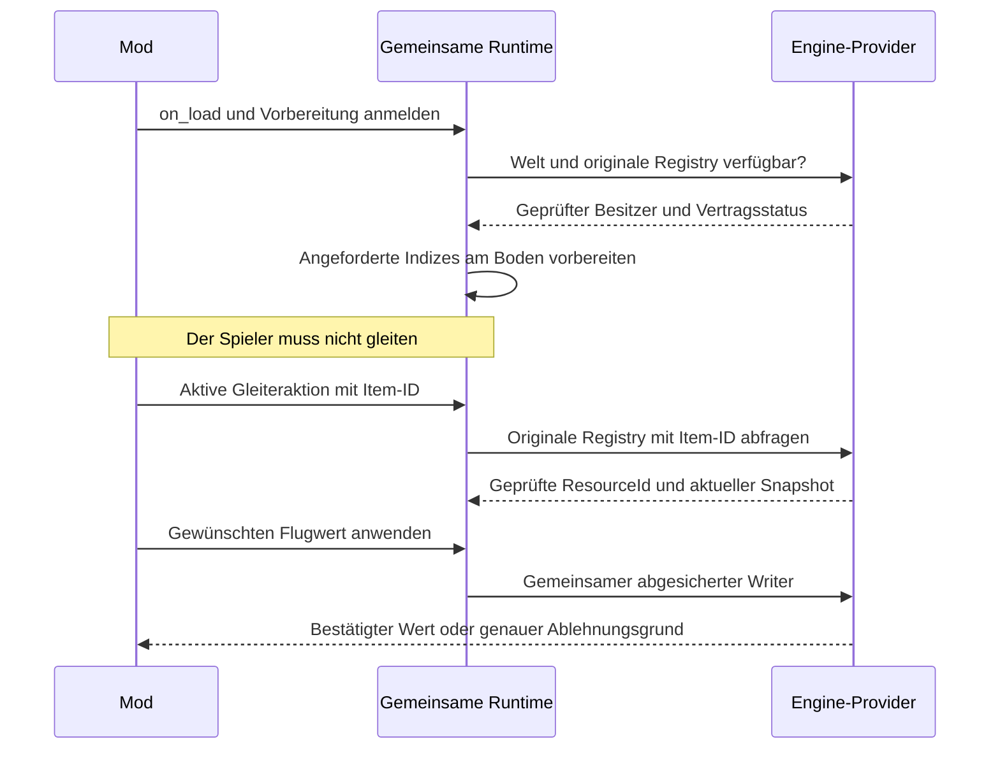

# Runtime-Performance: Umsetzung, Live-Messung und ursprünglicher Plan

Stand: 16. Oktober 2026. Der ursprüngliche Plan bleibt unten als Entwurfsstand
erhalten. Der folgende Abschnitt beschreibt den inzwischen implementierten und
geprüften Stand. R2 ist installiert, 120 Sekunden live gemessen und vom Nutzer
im Spiel als funktionierend bestätigt. Messumfang und verbleibende Grenzen sind
unten getrennt angegeben.

## Umsetzungsstand und gemessene Ausgangslage

Die alte installierte Runtime wurde in einer geladenen Offlinewelt über eine
begrenzte Diagnosesitzung gemessen. Survival benötigte für 296 Updates insgesamt
75.098,5363 ms, im Mittel 253,71 ms. Flight benötigte am Boden für 383 Updates
30.095,4786 ms, im Mittel 78,58 ms. Das sind Laufzeiten der Lua-Callbacks,
keine Messungen der Bildrate. Aktiv waren Infinite Stamina, Infinite Mana und
No Fall Damage sowie der Flight-Mod mit den bisherigen Benutzereinstellungen.

Der aktuelle originale ItemRegistry-Vertrag wurde zusätzlich im laufenden Spiel
geprüft. Alle 4.207 belegten Item-IDs stimmten mit ihrem Payload überein und waren
denselben geladenen ItemInfo-Ressourcen zugeordnet. Die Hashmap benötigte im
Median eine und höchstens sieben Sondierungen. Der Nachweis bezieht sich auf
die Registry des Ressourcenbesitzers. Die Engine-Zuordnung wird beim Zugriff
erneut geprüft und ersetzt keine Schreibberechtigung.

Implementiert sind inzwischen:

- Gemeinsame, begrenzte Reflection-Pläne und Namensindizes ohne gespeicherte
  Live-Pointer oder Schreibrechte.
- Eine gemeinsame Queue im vorhandenen Runtime-Loop. Ein einmal angemeldeter
  Feldindex wird auch am Boden und ohne weitere Lua-Aufrufe vorbereitet.
- Native Batches für feste 32-Bit-Ressourcenschlüssel und ein direkter Resolver
  für den bestätigten originalen ItemRegistry-Vertrag.
- Eine geprüfte native Mehrkomponentenlesung für die vollständige
  Attribut-Kandidatenmenge. Abwesenheit und Lesefehler werden getrennt behandelt.
  Die Reihenfolge der Einzelkomponenten ist keine atomare Gesamtsicht.
- Eine kompakte Abfrage der aktuellen passenden Registrierungszeilen für
  Template-Zugriffe. Die vollständige Registry mit Callback-Codebytes wird
  dafür nicht mehr bei jedem Update serialisiert und geparst.
- Gezielte Indexinvalidierung bei bekannten Ressourcenwrites sowie eine
  Fortschreibung der Callbacktermine ohne Nachholschleifen.
- Begrenzte optionale API-Messwerte im vorhandenen Runtime-Status unter
  `runtimeProvider.apiMetrics` und Queuezähler unter `resourceIndexes`.

Die gemeinsamen Rechte-, Identitäts-, Claim-, CAS-, Readback- und Restore-Regeln
bleiben erhalten. Ein älterer nativer Provider ohne geprüfte
Mehrkomponentenlesung liefert für diese Attributauflösung ausdrücklich einen
Fehler. Fehlgeschlagene Einzelreads werden nicht als belegte Abwesenheit benutzt.
Andere ausdrücklich unterstützte Ressourcenlesepfade behalten ihre bisherigen
Fallbacks. Ein neuer Spielbuild benötigt weiterhin einen passenden geprüften
nativen Vertrag.

Die API-Prüfung bestand mit 73 Bibliothekstests und den Flight-, Survival-,
Override-, Produktionszeit- und World-Editor-Integrationen. Sechs
Bibliothekstests und zwei zusätzliche Produktionszeittests mit erforderlichen
externen Eingaben blieben ausdrücklich ignoriert. Die nativen Fixtures bestanden
mit 184 ECS-, 761 Ressourcen- und 47 Serviceprüfungen. Fixture-Laufzeiten werden
nicht als Verbesserung im echten Spiel ausgegeben.

Das Queuebudget ist kooperativ. Eine bereits gestartete native Operation und
das bisherige Gesamtlisting können die Millisekunde überschreiten. Die Queue
zählt solche Überschreitungen. Die bestehende Konfigurationsübernahme von etwa
einer Sekunde und der 16-ms-Bootstrap-Wartezyklus wurden nicht beschleunigt.
Der folgende ursprüngliche Plan enthält weitergehende Abnahmeziele. Diese sind
keine Zusage bereits gemessener Reaktionszeiten.

### Liveprüfung der ersten Integration

Die erste Integration wurde mit beiden per SHA-256 bestätigten neuen DLLs im
Spielprozess 20384 installiert und 120 Sekunden gemessen. Der Nutzer bestätigte
die Wirkung beim ersten Flug ausdrücklich als unmittelbar funktionierend.
Der Feldindex war bereits am Boden fertig, mit 4.262 Schlüsseln in 67 nativen
Batches und ohne vollständige Payloadreads für die Suchkandidaten.

Die allgemeine Aufrufleistung hat diese erste Integration dagegen noch nicht
verbessert. Der Vergleich der ersten 9,91 Sekunden vor dem ersten beobachteten
ItemRegistry-Aufruf ergab rund 417,01 ms für Survival und 135,77 ms für Flight
je Callback. In der gesamten gemischten Boden-/Flugmessung lagen die Werte bei
434,79 ms beziehungsweise 187,23 ms. Diese Werte werden ausdrücklich nicht als
Performancegewinn ausgegeben.

Der gemessene Engpass ist die native Mehrkomponentenlesung mit 85,14 ms je
Aufruf über 1.056 Aufrufe. Die Root-Zuordnung benötigte dagegen rund 0,083 ms,
die Attributberechnung rund 0,049 ms und die kompakte Registrierung rund
0,113 ms. Der direkte ItemRegistry-Resolver benötigte etwa 0,057 ms in einem
Zwischenstand derselben Messung. Die erste Queue-Vorbereitung erreichte einen
maximalen Schritt von 183,25 ms und 34 Budgetüberschreitungen. Alle nativen
Batchaufrufe waren erfolgreich, die Modcallbacks meldeten keine Fehler.

Die nächste Korrektur behandelt die belegten mehrfachen `VirtualQuery`-Aufrufe
im nativen Leser und die zusätzliche Größenabfrage vor jedem vollständigen
Ressourcenread. Ihr tatsächlicher Gewinn muss erneut im Spiel gemessen werden.
Belege liegen im lokalen Buildverzeichnis unter
`runtime-performance-baseline-20261016/live-20261016T185634Z`. Die begrenzte
Diagnosekonfiguration wurde danach bewacht auf ihren Originalzustand
zurückgesetzt.

### Nachgewiesener Vertikalflugfehler

Eine anschließende rein lesende Aufzeichnung mit 20 Hz erfasste 5.400 gültige
Samples. Darunter waren 671 Gleitersamples und 92 tatsächliche
Orientierungswechsel über 120°. Globale Quaternion-Vorzeichenwechsel wurden
dabei als dieselbe Orientierung behandelt. Der größte Richtungswechsel betrug
180°. Die erste erfasste echte Umdrehung geschah zwischen
19:15:13,193 und 19:15:13,243 UTC nahe der Senkrechten. Gleiter-ID, GUID und der
reflektierte Offset der Pitchrate wurden gegen den originalen Datenpfad geprüft.

Die bisherige Regelung verwendete unverändert einen Vorhersagehorizont von
0,25 Sekunden. Die tatsächlich gemessenen Updateabstände konnten diesen Wert
überschreiten. Eine negative Pitchrate kann deshalb über die Senkrechte hinaus
aktiv bleiben. Die verwendete `asin`-Projektion unterscheidet anschließend die
umgeklappte Lage nicht von der normalen Lage. Im Trace blieb eine negative Rate
auch bei neutraler Eingabe bestehen. Eine gleichzeitige Lua-Effektbestätigung
für den ursprünglichen Flip fehlt und wird nicht nachträglich behauptet.

Die Korrektur verwendet beobachtete Updateabstände und erkennt zusätzlich die
umgekehrte Lage anhand der reflektierten Orientierung und Gravitation. Sie
schreibt keine Quaternion-Reparatur. Eine endliche Abtastung kann eine beliebig
lange spätere Lua-Pause weiterhin nicht zu einem harten Engine-Pitchlimit machen.
Die Rohdaten und die kompakte
Auswertung liegen unter `build/flight-vertical-live-20384.jsonl` und
`build/flight-vertical-summary-20384.json`.

### Installierter und live geprüfter Stand R2

`1.6.8-runtime-performance-20261016-r2` wurde am 16. Oktober in Prozess 31756
über 120,20 Sekunden und 159 Statussamples gemessen. Beide geladenen DLLs und
die Flight-Lua-Datei wurden über ihre SHA-256-Prüfsummen bestätigt. Die
Benutzereinstellungen der beiden Mods wurden nicht ersetzt. Der Nutzer
bestätigte anschließend ausdrücklich die problemlose Funktion. Es wurden keine
weiteren Reproduktionsversuche verlangt.

| Gemessener Aufruf | Erste Integration R1 | Korrigierter Stand R2 |
| --- | ---: | ---: |
| Native Mehrkomponentenlesung | 85,14 ms | 15,27 ms |
| Vollständiger Ressourcenread | 7,90 ms | 0,056 ms |
| Template-Zugriff | 8,63 ms | 0,318 ms |
| Originale ItemRegistry-Auflösung | 0,057 ms | 0,055 ms |

R2 erfasste 724 Survival-Updates mit durchschnittlich 61,96 ms und 842
Flight-Updates mit durchschnittlich 57,53 ms. Diese Gesamtwerte mischen Boden
und Flug. Die kurze Bodenphase vor dem ersten beobachteten ItemRegistry-Aufruf
umfasst nur 4,58 Sekunden. Sie ist keine lange gesonderte Bodenmessung.
Die maximalen Callbackzeiten lagen bei 159,57 beziehungsweise 169,61 ms.
Eine garantierte allgemeine Reaktionszeit unter 50 ms ist damit nicht belegt.

Alle 5.099 nativen Komponenten-Batches waren erfolgreich. Es gab keine
Callback-, Mod-, Batch- oder Lesefehler. Der gemeinsame ItemInfo-Index war
erneut vor der ersten beobachteten Flugaktion bereit, mit 4.262 Schlüsseln in
67 Batches und ohne vollständige Kandidaten-Payloadreads. Im Messfenster
entstanden keine weiteren Queuefehler. Die historischen Fehlerzähler stammen
aus der Zeit vor Weltladung. Die vorherige Vorbereitung erreichte in dieser
Sitzung maximal 27,10 ms pro Runde und 28 Budgetüberschreitungen. Ihre gesamte
kalte Startdauer wurde nicht gemessen.

Die Beschleunigung liegt in der gemeinsamen API. Der native Batch teilt
Regionsprüfungen innerhalb eines Aufrufs und validiert die Region zum Abschluss
erneut. Geprüfte Kopien, Identität, Generation, Tabellenzugehörigkeit und
Adressen bleiben erhalten. Direkte GUID-Abfragen erfassen jetzt den vollständigen
Snapshot sofort, ohne vorherige Größen- und Existenzabfrage im Erfolgsfall.
Listeneinträge bleiben hinsichtlich ihrer Payloads verzögert lesbar. Alle Mods,
die diese öffentlichen API-Pfade verwenden, benutzen dieselbe Implementierung.

Die zusätzliche R2-Rohwinkelaufnahme begann erst nach dem Nutzerflug und
enthielt ausschließlich Bodenwerte. Sie liefert keinen eigenständigen
quantitativen Winkel- oder Eingabelatenznachweis. Die Funktionsbestätigung des
Nutzers, die API-Messung während des Fluges, die Regressionen und der frühere
R1-Fehlertrace sind getrennte Belege.

Die Diagnose wurde vollständig und bewacht auf `enabled=false`,
`continuous=false` und die ursprüngliche Request-ID zurückgesetzt. Die
Messbelege liegen unter
`build/runtime-performance-baseline-20261016/live-20261016T192734Z`.
Das Installationsbackup mit sämtlichen Dateihashes liegt unter
`build/runtime-performance-install-20261016-212621/manifest.json`.
Das Paket heißt `build/shroudforge-1.6.8-runtime-performance-20261016-r2.zip`.

Die folgenden Abschnitte 1 bis 15 enthalten den ursprünglichen Entwurf. Nicht
ausdrücklich oben als umgesetzt und gemessen bezeichnete Abnahmeziele daraus
sind weiterhin Ziele, keine zusätzlichen Testergebnisse.

## 1. Ziel und verbindliche Grenzen

Ein Mod soll seine benötigten Zugriffe vorbereiten können, sobald die passende
Spielwelt verfügbar ist. Der Spieler soll keine bestimmte Aktion über längere
Zeit ausführen müssen, damit die Runtime ihre Initialisierung fortsetzt.
Für Flight bedeutet das konkret: Die Vorbereitung läuft am Boden. Sobald der
Gleiter aktiv ist und seine Item-ID vorliegt, wird dessen vorhandene
Engine-Zuordnung unmittelbar benutzt oder ein bereits vorbereiteter Index
abgefragt.

Die Optimierung gilt für die gemeinsame Lua-API und damit für unabhängige
Community-Mods. Survival und Flight sind Abnahmeszenarien. Ihre Namen entscheiden
nicht darüber, welche Zugriffe die Runtime zulässt.

Die Ziele werden getrennt gemessen:

1. **Vorbereitung:** Zeit ab verfügbarer Welt und gültigem Ressourcenbesitzer bis
   zu einer benutzbaren Verbindung oder einem fertigen Suchindex.
2. **Erster Einsatz:** Zeit von einer gültigen Spielaktion beziehungsweise
   Einstellung bis zum ersten bestätigten Datenzugriff.
3. **Dauerbetrieb:** CPU-Aufwand, Speicheraufwand, native Zugriffe und tatsächliche
   Callbackabstände nach erfolgter Vorbereitung.
4. **Änderungen:** Kosten und Verhalten bei Modwechsel, Weltwechsel, Hotfix,
   Ausrüstungswechsel, konkurrierenden Mods und vorübergehend belegten Engine-Gates.

Eine Ressource, deren Besitzer noch nicht verfügbar ist, kann nicht sicher
vorab benutzt werden. Eine Suche über ein beliebiges bisher unbekanntes Feld
kann ebenfalls nicht grundsätzlich ohne Vorbereitung sofort antworten. Die API
muss diesen Zustand früh und ausdrücklich melden. Sie darf ihn nicht von einem
30 Sekunden langen Gleiterflug abhängig machen.

### Bestätigter Stand und Bedeutung der Sicherheitsfälle

Die bereits benutzten typisierten Datenpfade werden durch diesen Plan nicht
erneut als ungelöst eingestuft. Infinite Stamina wurde vom Nutzer im Spiel
bestätigt. Für Flight wurden ein aufgelöster Gleiter, Steuerinput und bestätigte
Schreibzugriffe beobachtet, und der Nutzer bestätigte die Flugwirkung.
Die aktuelle Gleiter-ID wurde dabei erfolgreich zugeordnet. Der Mitschnitt
belegt keine weiterhin offene Mehrdeutigkeit dieser konkreten Zuordnung.

Wenn die folgenden Abschnitte doppelte Schlüssel oder zwei passende
Attribut-Roots nennen, beschreiben sie die bereits vorhandenen Ablehnungsregeln
und deren Erhaltung bei der Optimierung. Die Prüfmatrix erzeugt solche Fehlerfälle
gezielt für unbekannte, konkurrierend veränderte oder künftige Daten. Sie ist
keine Liste erneut unaufgelöster Survival- oder Flight-Zuordnungen.

Die Performancearbeit verwendet vorhandene Auflösungen und vermeidet ihre
unnötige Wiederholung. Der direkte originale ItemRegistry-Resolver ist ein
zusätzlicher schneller Zugriffsweg und benötigt noch den benannten Nachweis für
den aktuellen Build. Das ist von der bereits funktionierenden generischen
Gleiterauflösung getrennt. Eine vollständige Auflösung aller Enginefunktionen
und die Liveprüfung jeder Survival-Einstellung werden hier nicht behauptet.

## 2. Was der aktuelle Code tatsächlich tut

| Bereich | Belegter Ablauf | Folge |
| --- | --- | --- |
| Generische Ressourcensuche | `loaded_index.rs` liest höchstens 64 vollständige Payloads pro Lua-Aufruf. Erst nach der gesamten erfassten Liste wird ein eindeutiger Treffer veröffentlicht. | 4.262 Einträge benötigen mindestens 67 erfolgreiche Aufrufe zum Vorantreiben der Suche. |
| Aufrufer in Flight | `current_glider()` wird erst nach erkannter aktiver Gleiteraktion und gültiger Item-ID aufgerufen. | Ohne passende Aktion pausiert die Indexarbeit. |
| Ressourcenmutation | `AppState::compare_exchange_loaded_resource_scalar()` verwirft nach jedem bestätigten Ressourcenwrite sämtliche Suchindizes. | Auch eine Änderung am Pitch kann einen unveränderten Item-ID-Index verwerfen und andere Suchaufträge zurücksetzen. |
| Ressourcenlesen | Rust fragt zunächst die Größe und danach den vollständigen Payload nativ ab. Der native Reader prüft Besitzer und Zuordnung mehrfach und kopiert den Payload für seine Konsistenzprüfung zweimal. | Ein vier Byte großer Suchschlüssel verursacht erheblich mehr Arbeit als vier gelesene Bytes. |
| Feldzugriff | `ecs_fields()` sucht den Typ über `registry.iter().find()` und löst die Feldpfade erneut auf. | Unveränderte Reflection-Arbeit wiederholt sich im laufenden Zugriff. |
| Attribut-Override | Die Target-Erstellung liest Attribute. Der Claim-Erwerb liest die Komponente erneut. `apply()` liest anschließend den aktuellen Root wieder. | Auch ein unveränderter Wert verursacht mehrere native Snapshot-Operationen. |
| Attributzuordnung | `resolve_storage()` prüft mehrere kompatible Komponenten auf ihren tatsächlichen initialisierten Root. | Diese Arbeit enthält eine notwendige Mehrdeutigkeitsprüfung und darf nicht pauschal entfallen. |
| ECS-Query | Es existieren bereits ein gemeinsamer Query-Cache, erneute Handleprüfungen und ein inkrementeller Scan mit Zeitlimit. | Ein zweiter allgemeiner ECS-Query-Cache wäre zusätzliche Struktur ohne belegten Nutzen. |
| Scheduling | Der Bootstrap wartet pro Runde 16 ms. Lua-Callbacks laufen nacheinander. Der nächste Callbacktermin wird derzeit nach Abschluss um das Intervall verschoben. | Arbeitszeit und andere Aufgaben kommen zum gewünschten Intervall hinzu. 16 ms sind keine garantierte Callbackfrequenz. |

Diese Befunde erklären mögliche Verzögerungen. Sie sind keine Messung eines
30-Sekunden-Scans und kein Nachweis, dass genau eine Ursache den gesamten
bisherigen Ausfall erklärt. Beim erfolgreichen Liveversuch wurden zusätzlich
beide Mods neu geladen. Der erste Reload hatte ausstehende Bereinigung.

Primäre Quellen:

- [Ressourcenindex](../../src/loader/api/src/env/game/assets/loaded_index.rs).
- [Zentraler Ressourcenwriter und AppState](../../src/loader/api/src/env/app_state.rs).
- [Lua-Targets](../../src/loader/api/src/shroudforge/v1/lua/override_targets.lua) und
  [Override-Verwaltung](../../src/loader/api/src/shroudforge/v1/lua/overrides.lua).
- [ECS- und Provider-Bindings](../../src/loader/api/src/env/loader.rs).
- [Attributzugriff](../../src/loader/api/src/env/runtime_attributes.rs) und
  [Claims](../../src/loader/api/src/env/runtime_ownership.rs).
- [Nativer Ressourcenreader](../../src/loader/runtime/native/resource/resource_runtime.cpp)
  und [ECS-Provider](../../src/loader/runtime/native/ecs/ecs_runtime.cpp).
- [Runtime-Loop](../../src/loader/api/src/lib.rs) und
  [Bootstrap](../../src/bootstrap/windows/bootstrap.cpp).

## 3. Zuständigkeiten im Zielzustand

Die Umsetzung erweitert vorhandene Besitzer der jeweiligen Aufgabe:

| Aufgabe | Kanonischer Besitzer |
| --- | --- |
| Geprüfte Reflection-Pläne | `AppState`, mit der aktiven TypeRegistry verbunden |
| Suchindizes und anstehende Ressourcenaufträge | Bestehende `loaded_resource_indexes` in `AppState` |
| Planung und Fortschritt | Bestehender `IngameRuntime::update()` |
| Lesen und originale Registry-Zuordnung | Bestehender nativer ResourceService-Provider |
| ECS-Queries und Live-Handleprüfung | Bestehender nativer ECS-Provider mit seinem Query-Cache |
| Modrechte, Claims, Baselines und Restore | Bestehende Ownership- und Override-Verwaltung |
| Messwerte und Fehleranzeige | Bestehendes `runtime-diagnostics`, Runtime-Status und Logs |

Die Suchwarteschlange plant Vorbereitung und Discovery. Sie verleiht keinem
Auftrag eine Schreibberechtigung oder einen zulässigen Engine-Ausführungskontext.
Vorhandene Gameplay-Dispatcher und Weltoperationen behalten ihre eigenen
Ausführungsverträge. Netzwerk-, Datei- und Patchoperationen werden nicht allein
wegen eines gemeinsamen API-Namens in eine Ressourcenwarteschlange verlegt.

## 4. Erste Wirkung ohne langen Flug

### 4.1 Direkter Engine-Bezug für Item-IDs

Eine Item-ID ist kein vollständiger `ResourceId`. Das Originalspiel besitzt dafür
eine ItemRegistry. Die frühere Untersuchung belegt deren ID-Map und ihre
Verbindung zum ResourceService für Build 25966634. Die Map wurde noch nicht als
öffentlicher Resolver für den aktuellen Hotfix implementiert.

Für die neue direkte Registry-Abkürzung muss der aktuelle Mapvertrag geprüft
werden. Der bestehende generische Ressourcenweg dient als bereits
implementierter Vergleichspfad:

1. Originalen Gameplay-Verbraucher und die tatsächlich verwendete Registry
   bestimmen. Client und autoritative Welt können unterschiedliche Wrapper haben.
2. Besitzer, Maplayout, Schlüsseltyp, Belegung, Werttyp und Lebensdauer prüfen.
3. Nach einem Map-Treffer Item-ID und GUID aus dem reflektierten ItemInfo lesen.
4. Den kanonischen `ResourceId` einschließlich der belegten Teilindexregel bilden.
5. Diesen Schlüssel über den vorhandenen ResourceService auflösen und prüfen,
   dass er denselben Payload wie die originale Registry bezeichnet.
6. Den normalen `Resource` zurückgeben. Schreiben, Claims und Restore laufen
   anschließend über die bestehenden gemeinsamen Wege.

Eine Registry-Vorbereitung benötigt noch keine aktuell benutzte Item-ID. Sie
prüft ihren Vertrag, sobald der autoritative Besitzer verfügbar wird. Erst der
konkrete Lookup benötigt die ID. Ein Originalgetter wird dabei nicht ohne
nachgewiesenen Aufrufvertrag aufgerufen. Die Map kann lesend ausgewertet werden.

Geplante additive Schnittstelle im bestehenden Namensraum:

```lua
-- Vorschlag. Diese Funktion existiert derzeit noch nicht.
local resource, reason, status = game.assets.resolve_loaded_resource(
    "g38_items::ItemRegistry", item_id)
```

Der Registry-Name bezeichnet einen im Provider belegten Engine-Bezug. Er ist
keine Mod-ID und keine Erlaubnis, beliebige native Speicherstrukturen zu lesen.
Key-Typ, Zieltyp und zulässiger Besitzer gehören in den geprüften Providervertrag.
Buildabhängige Anschlussdaten stehen zentral im Profil, nicht in jedem Mod.
Der genaue exportierte Registry-Name wird mit der aktuellen Engine-Zuordnung
abgeglichen, bevor die API festgelegt wird.

**Diese Funktion hat eine andere Bedeutung als die generische Feldsuche.** Sie
liefert den von der Engine gewählten Registry-Eintrag. Die Feldsuche prüft dagegen
auf Eindeutigkeit in ihrer gesamten erfassten Ressourcenliste. Ein Registry-Treffer
darf deshalb nicht stillschweigend das Mehrdeutigkeitsverhalten von
`get_loaded_resource_by_field()` verändern.

Quelle und noch zu portierender Beleg:
[Creative-Mode-Untersuchung](../../src/loader/runtime/profile-tools/dev/investigations/2026-10-16-creative-mode.md).
Ein Reflection-Typname allein beweist diese Verbindung nicht.

### 4.2 Allgemeine Indizes früh vorbereiten

Für beliebige unterstützte Feldsuchen bleibt der allgemeine Index notwendig.
Damit ein Mod ihn vor seiner Spielaktion vorbereiten kann, reicht eine weitere
additive Funktion im vorhandenen AssetManager:

```lua
-- Vorschlag. Registriert Vorbereitung für diesen aktiven Mod.
-- Ein fehlender Weltbesitzer führt zu pending, nicht zu einer blockierenden Suche.
local ready, reason, progress = game.assets.prepare_loaded_index(
    "keen::ItemInfo", "itemId.value")
```

Diese Anmeldung ist idempotent und benötigt keinen erfundenen Suchwert.
Sie kann in `on_load` erfolgen. Die aktive Modinstanz hält einen Auftrag für
Typ und Feldpfad. Sobald die Welt bereit ist, entsteht daraus der gemeinsame
Indexauftrag. Ein bestätigter Weltwechsel startet ihn für die neue Sitzung neu.
Beim Mod-Unload entfällt dessen Anmeldung. Andere interessierte Mods behalten
ihren gemeinsamen Auftrag.

Bestehende Mods dürfen weiterhin nur
`get_loaded_resource_by_field(type, path, value)` verwenden. Der erste Aufruf
meldet bei Bedarf denselben Auftrag an. Seine Fertigstellung hängt anschließend
nicht von weiteren Lua-Aufrufen ab. Ohne frühzeitige Vorbereitung kann eine
erstmals angeforderte beliebige Feldsuche weiterhin `pending` sein.

### 4.3 Ablauf für Flight als Abnahmeszenario



Flight verwendet bevorzugt den belegten originalen Item-Bezug. Ein optionaler
Fallback auf die generische Suche wird vorher vorbereitet. Ist keine Strecke
benutzbar, meldet der Mod Vorbereitung oder den genauen fehlenden Vertrag.
Er meldet nicht pauschal eine fertige Flugfunktion.

## 5. Gemeinsame Queue und Ablauf pro Runtime-Runde

### 5.1 Ein Auftrag pro Index

Der Indexschlüssel besteht aus Provider-/Reflection-Identität, Weltsitzung,
Ressourcentyp und normalisiertem Feldpfad. Verschiedene Suchwerte benötigen
keinen eigenen Index. Zwanzig Mods mit demselben Typ und Feldpfad teilen sich
denselben Aufbau, behalten aber ihre eigenen Rechte und Ergebnisabfragen.

Die bestehende Indexstruktur erhält Jobzustand und Fortschritt. Eine
`VecDeque` enthält nur die Schlüssel anstehender Jobs. Es entsteht keine zweite
Ressourcendatenbank neben dem vorhandenen Indexspeicher.

Interne Zustände:

```text
waiting-owner -> queued -> listing -> scanning -> confirming -> ready
                                  |             |
                                  +-> retryable +-> invalidated
                                  +-> unavailable
jeder Zustand -> cancelled bei nicht mehr gültiger Sitzung oder Anmeldung
```

`ready` bedeutet bei generischen Indizes: vollständig erfasster Suchsnapshot.
Es bedeutet keine atomare Beobachtung aller Ressourcen zu einem einzigen
Zeitpunkt. Ein konkreter Treffer wird vor Ausgabe erneut geprüft.

### 5.2 Reihenfolge einer Runde

1. Aktuelle Sitzung und Providerzustand beobachten. Ungültige Jobs abbrechen.
2. Notwendige Lifecycle- und Restore-Schritte im bestehenden Ablauf behandeln.
3. Fällige Live-Callbacks ausführen. Jeder Mod wird höchstens einmal pro Runde
   aufgerufen. Ein Mod kann hier einen neuen Suchauftrag anmelden.
4. Die Suchqueue mit einem **gemeinsamen** Wartungsbudget weiterführen.
5. Status und Diagnose mit ihrer eigenen begrenzten Frequenz veröffentlichen.
6. Über das bestehende Stop-Event bis zur nächsten sinnvollen Fälligkeit warten.

Die genaue Integration muss die bestehende Initialisierung, Reload-Reihenfolge
und Statusveröffentlichung berücksichtigen. Lange Lua-Callbacks bleiben messbare
Last. Eine gemeinsame Lua-Instanz lässt sich nicht beliebig parallel unterbrechen.

### 5.3 Fairness und Arbeitsbudget

- Ein Schedulerbudget gilt für alle Suchjobs zusammen, nicht je Mod.
- Ein Job bekommt eine begrenzte native Teiloperation und wandert danach ans Ende.
- Alternde wartende Jobs werden bedient. Ständig neu angemeldete Jobs verdrängen
  keinen schon laufenden Auftrag dauerhaft.
- Der Scheduler begrenzt Zeit, Datensatzanzahl, kopierte Bytes und Speicher.
- Listenaufnahme und Kandidatenbestätigung zählen zum Budget. Versteckte
  vollständige Ressourcenlistings außerhalb der Messung sind ausgeschlossen.
- Busy-Gates führen zu einem späteren Versuch. Es gibt keine aktive Warteschleife.
- Eigene Registrierungen pro Mod und der gesamte Auftragsspeicher sind begrenzt.
  Überlastung wird ausdrücklich gemeldet. Ein benutzter Auftrag wird nicht
  stillschweigend durch einen neuen verdrängt.

Als Startziel für den Prototyp gilt 1 ms Wartungsarbeit pro Runtime-Runde.
Diese Zahl ist ein zu prüfendes Entwicklungsziel, keine gemessene Zusage.
Die Begrenzung ist kooperativ. Eine bereits begonnene native Operation oder
Betriebssystemunterbrechung kann darüber hinauslaufen. Deshalb bleiben kleine
Batchgrenzen und Messungen der tatsächlichen Höchstdauer erforderlich.

Für den Prototyp gelten folgende explizite interne Startgrenzen. Sie sind
keine neuen Benutzereinstellungen. Ihre Auslastung gehört zur Referenzmessung:

| Speicher oder Arbeit | Vorgesehene Startgrenze |
| --- | --- |
| Aktive gemeinsame Indexjobs | 16, entsprechend der bisherigen maximalen Indexanzahl |
| Unterschiedliche Voranmeldungen je Mod | 16. Gleiche Selektoren werden zusammengeführt. |
| Geprüfte Metadatenpläne | Höchstens 4.096 Einträge und insgesamt 16 MiB, maßgeblich ist die zuerst erreichte Grenze |
| Gemeinsamer zusätzlicher Listing-/Indexspeicher | 64 MiB einschließlich Jobdaten und Schlüsselzuordnungen, vor jeder Erweiterung geprüft |
| Schlüssel je nativer Teiloperation | Höchstens 64, bei gemessener langer Laufzeit kleinere Batches |
| Diagnose-Messreihen | Bestehende Grenze von 1.024 Einträgen, Perzentile über begrenzte Histogramme |

Diese Startwerte sind Kapazitätsentscheidungen, keine bereits gemessenen
Optimalwerte. Speicherbedarf wird einschließlich Container- und
Allokationsaufwand berücksichtigt. Bestehende Sicherheitsgrenzen für finale
vollständige Ressourcensnapshots bleiben zusätzlich erforderlich. Eine volle
Queue darf neue Voranmeldungen mit einem klaren Kapazitätsgrund ablehnen.
Unbenutzte fertige Suchdaten und Metadatenpläne dürfen begrenzt verdrängt
werden. Aktive Claims, Restores und deren Baselines dürfen dafür niemals
verworfen werden. Ein für den Aufrufer sichtbarer laufender Job wird nicht
unbemerkt neu gestartet.

Mehrere Jobs sind gleichzeitig angemeldet. Ihre Spielspeicherzugriffe werden
zunächst kontrolliert nacheinander im vorhandenen Runtime-Ausführungspfad
abgearbeitet. Weitere Threads kommen erst bei belegtem Bedarf und geklärtem
Engine-Lebensdauervertrag infrage. Reine Arbeit auf bereits kopierten eigenen
Bytes kann später separat parallelisiert werden, ohne Lua oder Enginepointer
an Worker zu geben.

## 6. Native Schlüssel gebündelt lesen

Der generische Suchschlüssel ist heute ein fester, ausgerichteter 32-Bit-Wert.
Der Aufbau benötigt zunächst dessen Bits und die zugehörige Ressourcenidentität,
nicht für jeden Kandidaten die gesamte dekodierte Ressource.

Geplante interne Erweiterung des bestehenden Providers:

```text
ScanResourceScalars(
    erwartete Sitzung und Provideridentität,
    erfasste ResourceIds oder begrenzter Listing-Cursor,
    geprüfter Zieltyp, Rootgröße, Schlüsseloffset und Schlüsselbreite,
    begrenzter Ausgabepuffer
) -> kopierte ResourceIds, Schlüsselbits, Fortschritt und typisierter Status
```

Das ist ein Entwurf für einen optionalen ABI-Export. Sein endgültiges Layout
wird in `runtime.h` festgelegt und auf beiden Seiten identisch geprüft.

Pro Teiloperation sind erforderlich:

1. Größen, Integerüberläufe, Typ, Offset und vier Byte breite Ausrichtung prüfen.
2. Besitzer und ResourceService-Bindung im aktuellen Vertrag auflösen.
3. Die Lebensdauer während des Zugriffs im belegten Originalkontext sichern.
4. Jede vollständige ResourceId, ihren Handle, Chunk und gültigen Span prüfen.
5. Nur die festen Schlüsselbits kopieren und ihre Konsistenz erneut prüfen.
6. Besitzer, Sitzung und betroffene Zuordnungen vor Veröffentlichung bestätigen.
7. Ausschließlich eigene IDs und Bytes zurückgeben, keine nutzbaren Prozesspointer.

Die Reflection entscheidet, welcher Schlüsseloffset zulässig ist. Lua kann
keinen beliebigen Offset als Ersatz für einen Feldpfad übergeben.
Vollständige Payloads bleiben für den abschließenden Kandidaten und für den
bestehenden Schreibvertrag erforderlich.

Auch das aktuelle doppelte vollständige Typ-Listing für Größenabfrage und
Ausgabe muss vermessen und durch einen begrenzten Listing-Vertrag ersetzt
werden. Ein Cursor hält eine Providerbindung beziehungsweise einen eigenen
Listing-Snapshot, niemals einen ungeprüften Iterator in beweglichen Enginearrays.

`ResourceLifeGuard` schützt laut seinem Vertrag die Lebensdauer. Er beweist
weder unveränderliche Schlüsselwerte noch eine unveränderliche Mapmitgliedschaft.
Diese Eigenschaften benötigen eigene Prüfungen. Speicherallokationen und eigene
Mutexe werden vor originalen Engine-Gates vorbereitet. Es erfolgt kein Lua-Aufruf
unter diesen Gates und kein Halten eines Gates über mehrere Runtime-Runden.

## 7. Fehlerbehandlung, Indexgültigkeit und Invalidierung

### 7.1 Fehler nicht als fertiges Suchergebnis behandeln

Die neue native Batchstrecke unterscheidet mindestens:

| Status | Verhalten |
| --- | --- |
| `ok` | Geprüfte Zeilen übernehmen. |
| `busy` | Mit gültigem Fortsetzungsvertrag später erneut versuchen. |
| `stale-context` | Auftrag für den alten Besitzer abbrechen und neu anmelden. |
| `not-loaded` während einer Erfassung | Listing und Mitgliedschaft erneut bewerten. Einen ungelösten Kandidaten nicht stillschweigend überspringen. |
| `invalid-layout` oder `unsupported` | Genau benannten Vertrag als nicht verfügbar melden. |
| dauerhaft unvollständige Erfassung | `incomplete` mit Ursache ausgeben, niemals daraus `not found` oder einen eindeutigen Treffer ableiten. |

Das aktuelle boolesche Read-ABI liefert diese Unterscheidung nicht zuverlässig.
Die neue Strecke darf deshalb Fehlertexte nicht zur vermeintlich sicheren
Fortsetzung umdeuten. Ohne belegten Fortsetzungstoken wird konservativ neu
aufgebaut. Ein Token muss tatsächlich die benötigte Besitzer- und
Erfassungsidentität abdecken. Gleiche Arraypointer und Zähler allein beweisen
keine unveränderten Inhalte.

Ein fehlerhafter Kandidat erhöht `scanned` nicht. Bereits erkannte doppelte
Schlüssel gehen bei Wiederholung nicht verloren. Erst die vollständige,
zulässige Erfassung kann einen eindeutigen generischen Treffer liefern.

### 7.2 Bestätigte lokale Änderungen gezielt behandeln

Ein Index speichert zusätzlich den geprüften Bytebereich seines festen
Schlüsselfeldes. Nach einem bestätigten lokalen skalaren Write gilt:

- Anderer Ressourcentyp: Index behalten.
- Gleicher Typ, anderer nicht überlappender Schlüsselbereich: Index behalten.
- Änderung am indizierten Schlüsselbereich: betroffenen Index invalidieren.
- Unklarer Writeausgang: konservativ invalidieren und die bestehende Sperre
  weiterer Schreibversuche erhalten.
- Welt-, Provider- oder Reflectionwechsel: zugehörige Jobs und Bindungen verwerfen.

Ein Pitch-Write darf somit den `ItemInfo.itemId`-Index nicht zurücksetzen.
Die zentrale Umsetzung in `AppState` gilt auch für Template-Schreibwege.

### 7.3 Externe Engine-Änderungen ausdrücklich berücksichtigen

Heute werden positive Indizes unbegrenzt behalten. Die erneute Prüfung eines
gefundenen Kandidaten erkennt nicht, ob inzwischen eine zweite Ressource
denselben Suchwert besitzt. Ein TTL allein beweist ebenfalls keine aktuelle
Eindeutigkeit.

Das ist eine bereits dokumentierte Grenze des generischen Suchsnapshots.
Sie ist kein Beleg für einen neu aufgetretenen Zuordnungskonflikt bei Flight.

Das Konzept unterscheidet deshalb:

- **Originale Registry-Auflösung:** Ergebnis nach dem aktuell geprüften
  kanonischen Engine-Vertrag.
- **Generische Feldsuche:** eindeutiger Wert im vollständig erfassten
  Suchsnapshot, anschließend erneut bestätigter Kandidat.

Für eine stärkere Garantie aktueller globaler Eindeutigkeit braucht es eine
belegte Engine-Generation oder Original-Synchronisation, die sowohl
Mitgliedschaft als auch Änderungen des betreffenden Schlüssels abdeckt.
Solange diese fehlt, werden Alter und Ursprung der Erfassung dokumentiert,
Erfassungen begrenzt erneuert und keine transaktionale Eindeutigkeit behauptet.
Ein statischer KFC-Dateikatalog kann Kandidaten liefern. Er ersetzt diese
Laufzeitprüfung nicht.

## 8. Reflection-Arbeit einmalig ausführen

`AppState` erhält einen begrenzten gemeinsamen Speicher für geprüfte Feldpläne.
Schlüssel: aktive Reflection-Identität, TypeIndex und normalisierter Feldpfad.

Für feste Inlinefelder enthält ein Plan Typ, Offset, Breite, Codec und die
geprüften Layoutgrenzen. `ecs_fields()` verwendet außerdem den vorhandenen
indizierten `get_by_name` statt einer linearen Suche über alle Typen.
Die vorhandenen Attributkataloge erhalten Name- und Rootindizes, einschließlich
der Informationen über mehrdeutige Namen.

Alle betroffenen bestehenden Leser, Writer, Normalisierer und Erwartungsprüfer
nutzen dieselbe Auflösung. Für BlobArrays und Varianten wird nur die statische
Pfadstruktur vorbereitet. Aktuelle Deskriptoren, Variantenwahl, Längen und
Payloadgrenzen werden weiterhin an jedem aktuellen Snapshot geprüft. Ein für
eine Ressource berechneter dynamischer Offset darf nicht für andere Payloads
übernommen werden.

Der Speicher enthält keine aktuellen Spielwerte oder dauerhaften
Schreibberechtigungen. Vorübergehende Providerfehler werden nicht als
unveränderlicher negativer Reflection-Befund gespeichert.

Abnahme: Nach dem ersten Zugriff auf einen festen gültigen Feldpfad entstehen
im warmen Wiederholungsfall keine weiteren vollständigen Pfadauflösungen.
Neue Reflection oder neues `AppState` beginnt mit eigenen gültigen Plänen.

## 9. Attribut- und Override-Zugriffe zusammenführen

Bereits belegte Typ-, Feld- und Attributzuordnungen werden als vorbereitete
Zugriffspläne wiederverwendet. Für Stamina und den live bestätigten Flugweg ist
keine erneute fachliche Entschlüsselung pro Aufruf vorgesehen. Die folgenden
Ablehnungen betreffen geänderte, veraltete oder fehlerhafte Laufzeitdaten.

### 9.1 Wiederverwendbare Bindung

Die bestehende Target-Factory kann eine Bindung pro Modinstanz, Sitzung,
Entity-Handle einschließlich Generation, Selector und Reflection verwenden.
Sie hält den geprüften Zugriffsplan. Baseline, Claims und Restore bleiben
beim jeweiligen Tracker. Sie werden nicht zwischen unterschiedlichen Mods
geteilt. Der Verlust einer Modinstanz gibt einen noch aktiven Claim nicht frei.

Die Generationsbindung benutzt den vorhandenen opaque Entity-Handle und seine
nativen Prüfungen. Es entsteht kein zweites Entity-ID-System. Eine alte
erfolgreiche Snapshotprüfung bleibt nicht allein wegen eines gleichen
Cache-Schlüssels gültig.

Eine erneute Target-Anforderung darf denselben gültigen Zugriffsplan verwenden.
Abweichende erwartete Pfade, Serviceverträge oder Zielidentitäten gehören in
den Schlüssel und dürfen nicht über einen zu groben Cache vermischt werden.
Das bloße Vorhandensein einer Bindung belegt keine fortbestehende Berechtigung.

### 9.2 Eine geprüfte Bindungsoperation pro Apply

Eine private API-Operation soll innerhalb eines zusammenhängenden Ablaufs:

1. Modrechte und aktuelle Sitzung prüfen.
2. Die echte Entity und ihre tatsächlichen Attributkandidaten prüfen.
3. Den eindeutigen initialisierten Root bestimmen.
4. Den zugehörigen Claim erwerben.
5. Einen aktuellen geprüften Snapshot für genau dieses `apply` bereitstellen.

Damit müssen Target-Konstruktor, Claim und Adapter dieselbe vollständige
Rootauflösung nicht unabhängig wiederholen. Der interne Prüfbeleg ist ein
Rust-eigener Wert oder ein nicht fälschbares Handle. Eine normale Lua-Tabelle
gilt niemals als Beweis für Entity-Identität, Rechte oder erfolgte Prüfung.
Das öffentliche `claim:acquire()` behält seinen bestehenden Prüfvertrag.

Ein geprüfter Snapshot kann weiterhin mehrere Komponentenprüfungen und zwei
Payloadkopien umfassen. Es wird nicht pauschal ein einziger roher Speicherread
pro Attribut versprochen.

### 9.3 Was dabei erhalten bleiben muss

`resolve_storage()` weist zwei passende initialisierte Roots zurück. Ein Cache,
der nur Root und Typ speichert und aktuelle Header ungeprüft übernimmt, würde
diese Prüfung umgehen. Selbst ein unveränderter
Archetyp beweist nicht, dass sich kein kompatibler Komponentenheader geändert
hat. Eine weitere Verkürzung benötigt eine belegte Generation oder eine
geprüfte Signatur sämtlicher relevanter Header. Bis dahin werden doppelte
Auflösungen innerhalb einer Operation entfernt, nicht die Eindeutigkeitsprüfung.

Der eigentliche Write prüft weiterhin erwartete aktuelle Bytes unter den
originalen Gates und führt die vollständige verifizierte Attributberechnung aus.
Bestätigter Readback bleibt maßgeblich. Ein nachträglich fehlgeschlagener
Beobachtungsread darf einen bereits bestätigten Write nicht in einen
unbekannten Fehlschlag umdeuten oder seine Baseline verwerfen.

## 10. Dauerbetrieb und Callbackplanung

Feldpläne und Bindungen vorzubereiten ersetzt keine aktuellen Spielwerte.
Flugsteuerung benötigt weiterhin aktuelle Eingaben und Orientierung.
Statische Einstellungen sollen ihre Berechnung und Bindung dagegen bei
Änderung aktualisieren. Falls kein belegter Änderungszähler existiert, bleibt
eine angemessen häufige kontrollierte Überprüfung nötig.

Der Runner schreibt Callbacktermine relativ zum vorgesehenen Termin fort.
Verpasste Perioden werden übersprungen, nicht als Nachholschleife ausgeführt.
Jeder aktive Mod bleibt auf höchstens einen Callback je Runde begrenzt.

```text
wenn jetzt >= nächsterTermin:
    Callback einmal ausführen
    nächsterTermin = erster regulärer Termin nach dem Callbackende
```

Der Bootstrap kann über eine optionale Runtime-Fälligkeitsabfrage bis zur
nächsten benötigten Runde warten, weiterhin abbrechbar über das Stop-Event.
Eine begrenzte maximale Wartezeit sichert Lifecycle- und Statusarbeit.
Diese Änderung wird getrennt vermessen. Sie rechtfertigt weder Busy-Polling
noch eine harte Echtzeitgarantie gegenüber Betriebssystem und Spiel.

Der vorhandene ECS-Query-Cache bleibt bestehen. Gleiche Query-Schlüssel können
kanonisiert werden. Ergebnisse enthalten erneut geprüfte Handles. Component-
Adressen und unveränderlich angenommene Spielwerte werden nicht darin abgelegt.

Eine allgemeine native Mehrkomponenten-Snapshotoperation ist ein späterer,
messungsabhängiger Schritt. Sie kann gemeinsame Besitzer- und Entityarbeit
für mehrere Reads bündeln. Sie setzt keine atomare Gesamtsicht voraus, solange
diese nicht durch den originalen Ausführungskontext belegt ist.

### Einstellungsänderungen getrennt messen

Heute wird `refresh_configuration()` aus dem ungefähr einmal pro Sekunde
laufenden Statuszweig aufgerufen. Die Zeit vom gespeicherten UI-Wert bis zur
Übernahme in Lua ist deshalb ein eigener Anteil der beobachteten Reaktion.
Sie darf nicht mit der Laufzeit eines bereits vorbereiteten Datenzugriffs
verwechselt werden.

Im Scheduler-Schritt erhält die bestehende Revisionsprüfung eine eigene
Fälligkeit. Statusausgabe und Übernahme neuer Einstellungen müssen nicht
dieselbe langsame Frequenz haben. Nur geänderte Revisionen werden erneut
geparst. Die Prüfung aller Pakete bleibt begrenzt und wird separat gemessen.
Nach bestätigter Übernahme kann der betroffene Mod vorzeitig fällig werden,
weiterhin höchstens einmal pro Runde. Eine neue unabhängige Konfigurationsdatei
oder ein weiterer Dienst ist dafür nicht vorgesehen.

Gemessen werden getrennt UI-Eingabe, atomarer Dateicommit, erkannte Revision,
Lua-Übernahme und tatsächlicher Modzugriff. Ein 50-ms-Ziel für die aktive
Flight-Steuerung ist keine Zusage für diesen gesamten UI-Ablauf.

## 11. Sicherheitsregeln für sämtliche Aufrufer

| Grenze | Verbindliche Regel |
| --- | --- |
| Typ und Layout | Aktive Reflection, echtes Runtime-Layout und Feldgrenzen müssen zusammenpassen. |
| Identität | Welt, Providerzustand, Entity-Generation, Tabellenzugehörigkeit und aktuelles Layout werden nicht aus einem alten Cache übernommen. |
| Ressourcen | Vollständige ResourceId, aktuelle Besitzerbindung, Chunk und Span prüfen. |
| Rechte | Aktiver Mod, Capability, zulässiger Prozess und aktuelle Autorität gelten bei jedem tatsächlichen Write. |
| Modkonflikte | Claims und erste Baseline bleiben modbezogen. Ein fremder Mod darf keine bereits geänderte Baseline als Original übernehmen. |
| Enginekontext | Eine Queue oder ein Reflection-Treffer ersetzt keinen Original-Gate- oder Trackervertrag. |
| Mutation | Erwartete Werte, erforderliche Snapshots und bestätigter Readback bleiben erhalten. Der Attributpfad behält seine Attributauswertung, der Ressourcenpfad seinen geprüften Scalar-CAS. |
| Unklarer Ausgang | Bestehende Schreibsperre erhalten. Keine blinden Wiederholungen oder Restaurationsversuche. |
| Restore | Vor Deaktivierung und Reload über die vorhandene API wiederherstellen. Bei Busy Zustand und Claims behalten und kontrolliert erneut versuchen. |
| Lebensdauer | Keine rohen Payloadpointer oder gehaltenen Engine-Gates über Runtime-Runden. |
| Auslastung | Suchjobs, Pläne, Speicher und Teiloperationen begrenzen. Überlast ausdrücklich melden. |

Diese Regeln gelten auch für direkte öffentliche Writer außerhalb der
Override-Helfer. Die Optimierung verbessert Auflösung und Datentransport.
Sie beweist nicht automatisch die Gameplay-Wirkung jedes reflektierten Feldes
oder einen Aufrufvertrag für jede gefundene native Funktion.

## 12. Messung und konkrete Abnahmekriterien

Vorher und nachher werden auf derselben Maschine und einer vergleichbaren
Offlinewelt gemessen. Dokumentiert werden Build, Profil, Reflection,
Entityanzahl, aktive Mods, aktivierte Einstellungen und Testdauer.
Kalter Prozessstart, Mod-Reload und bereits warmer Dauerbetrieb werden getrennt.
Die vorhandene Diagnose kann dabei eingeschaltet werden, sie ist keine
funktionale Modabhängigkeit.

Zusätzliche Messwerte im bestehenden Diagnosesystem:

- Vorbereitungsbeginn, erste Verfügbarkeit und erste bestätigte Wirkung.
- Queuewartezeit, abgearbeitete Schlüssel, Jobneustarts und jeweilige Gründe.
- Kalte und warme API-Latenz mit Anzahl, p50, p95, p99 und Maximum.
- Native Aufrufe, tatsächliche Bytes, Snapshot-Operationen und Feldauflösungen.
- Treffer im Metadaten- und Bindungsspeicher.
- Busy-Gates, CAS-Konflikte, unklare Ergebnisse und Restore-Wartezeiten.
- Geplanter Callbacktermin, tatsächlicher Start, Laufzeit und Verspätung.
- Gesamte aktive Runtime-Zeit pro Runde, Queueanteil und Speichermaximum.

Perzentile verwenden begrenzten Speicher. Im normalen Betrieb werden keine
Logs pro Ressource und keine vollständigen Datenkopien für die Diagnose erzeugt.

| Abnahme | Ziel beziehungsweise harte Bedingung |
| --- | --- |
| Vorbereitung ohne Aktion | Jobfortschritt und Registryvorbereitung erfolgen bei geladener Welt am Boden. Diese Bedingung ist verbindlich. |
| Erster originaler Item-Lookup | Kein vollständiger ItemInfo-Scan, sobald der aktuelle Registryvertrag bereit ist. |
| Reaktion nach bereitem Bezug | Erster bestätigter Zugriff innerhalb von höchstens zwei tatsächlich ausgeführten Modupdates, sofern die Engine-Gates verfügbar sind. Für aktive Flight-Eingabe bei bereits vorbereiteten Daten und angefordertem 16-ms-Intervall gilt als Referenzziel p95 unter 50 ms. Die Messung beginnt mit dem gültigen Actor-Input. Survival und UI-Speicherung werden nach ihren jeweiligen Intervallen separat gemessen. |
| Generische Vorbereitung für 4.262 ItemInfo-Einträge | Entwicklungsziel: höchstens eine Sekunde nach stabilem verfügbarem Besitzer bei der definierten Referenzlast. Das ist vor Messung keine Zusage. |
| Queuebelastung | Gemeinsames Startziel 1 ms pro Runde. Jede Überschreitung durch einen Batch wird erfasst und dessen Größe geprüft. |
| Gleichartige Anfragen | Ein Indexjob für denselben Selector, unabhängig von der Zahl der beteiligten Mods. |
| Unabhängiger Write | Null Neustarts des Item-ID-Index durch Pitch- oder andere nicht überlappende Änderungen. |
| Warme feste Feldpfade | Null zusätzliche vollständige Reflection-Auflösungen nach der ersten gültigen Auflösung. |
| Warmer Attributzugriff | Doppelte vollständige Rootauflösungen aus Konstruktor, Claim und Read innerhalb eines Apply sind entfernt. Notwendige Kandidatenprüfungen bleiben messbar. |
| Scheduler | Keine Aufholbursts. Callbackverspätung und Höchstdauer verschlechtern sich durch die Queue unter derselben Last nicht. |
| Sicherheit | Alle bisherigen Ablehnungen bei veralteter Identität, Konflikt, Mehrdeutigkeit und unklarem Write bleiben erhalten. |

Ein bestätigter Zugriff ist ein API-/Speichernachweis. Der sichtbare
Gameplay-Effekt wird im Live-Abgleich zusätzlich und getrennt bewertet.

Wenn die Latenzziele nicht erreicht werden, wird der dafür verantwortliche
Messwert benannt. Eine weitere Erhöhung des Suchbudgets darf nicht verdeckt
Flugcallbacks verzögern. Für den ersten Flight-Einsatz ist die originale
Registryverbindung der vorgesehene direkte Weg. Eine Queue allein erfüllt diese
Abnahme nicht, wenn weiterhin eine lange Suche während des Flugs nötig ist.

## 13. Umsetzungsplan mit prüfbaren Liefergegenständen

| Schritt | Konkrete Arbeit | Betroffene vorhandene Stellen | Fertig, wenn |
| --- | --- | --- | --- |
| 0. Referenzmessung | Bestehende Diagnose um API-, Queue-, Byte- und Auflösungszähler ergänzen. Kalten Start und warmen Zustand erfassen. | `modules/runtime-diagnostics`, `api/src/lib.rs`, API-/Providergrenzen | Vergleichbarer Ausgangsbericht liegt vor. Noch keine Gewinnbehauptung. |
| 1. Wiederholungsarbeit entfernen | Indizierte Typauflösung, gemeinsame feste Feldpläne, Name-/Rootindizes im bestehenden Catalog und gezielte Invalidierung nach bekannten lokalen Writes. | `env/app_state.rs`, `env/loader.rs`, `env/runtime_values.rs`, `runtime_resolution/attributes.rs`, `env/runtime_attributes.rs`, `assets/loaded_index.rs` | Warme Pfade lösen nicht erneut auf. Fremde Suchindizes überleben einen nicht überlappenden Write. |
| 2. Ersten Item-Zugriff direkt anbinden | Aktuelle originale ItemRegistry vollständig prüfen. Zentralen nativen Resolver und additive Assets-Funktion implementieren. Vorbereitung bei Weltbereitschaft. | `native/resource/resource_runtime.cpp/.h`, `native/runtime.h`, Provider-Binding, bestehendes exaktes Clientprofil, `env/game/assets.rs` | Am Boden vorbereiteter Bezug liefert beim ersten Itemgebrauch ohne ItemInfo-Gesamtscan den originalen Registryeintrag. |
| 3. Queue und Voranmeldung | Arbeit aus Lua-Lookup herausnehmen. Gemeinsame Jobs mit Lifecycle, Fortschritt und Budget im Runtime-Loop betreiben. `prepare_loaded_index` ergänzen. | `assets/loaded_index.rs`, `env/app_state.rs`, `api/src/lib.rs`, `env/game/assets.rs` | Ein einmal angemeldeter Auftrag wird auch ohne weitere Modanfragen fertig. Andere Jobs erhalten Ausführungszeit. |
| 4. Native Batches | Begrenztes Listing und feste 32-Bit-Schlüssel gebündelt lesen. Fehler und Fortsetzungsverträge typisieren. | `native/runtime.h`, `native/resource`, optionaler ABI-Loader in `env/loader.rs`, `assets/loaded_index.rs` | Vollständige Payloadreads entfallen für Suchkandidaten. Sicherheits- und Vollständigkeitsregeln bestehen weiterhin. |
| 5. Attributpfad bündeln | Modbezogene Targets wiederverwenden. Private geprüfte Bindungsoperation für Rootauflösung, Claim und aktuellen Snapshot einführen. | `override_targets.lua`, `overrides.lua`, `runtime_ownership.rs`, `runtime_attributes.rs` | Redundante High-Level-Reads entfallen, öffentliche Claims und native CAS-Prüfung bleiben gleichwertig. |
| 6. Terminplanung | Deadlinefortschreibung und begrenztes Warten am nächsten Termin prüfen und anpassen. | `api/src/lib.rs`, `workflow/lib.rs`, `bootstrap/windows/bootstrap.cpp` | Weniger zusätzliche Drift, keine Nachholschleifen, weiterhin zuverlässiges Stoppen und Reload. |
| 7. Durchgängige Abnahme | Öffentliche Definitionen, Dokumentation, zwei unabhängige Mods und ein fremder Beispielmod mit denselben API-Pfaden prüfen. Ein konsistentes Paket bauen. | `definitions/runtime.lua`, `definitions/assets/manager.lua`, vorhandene Tests, Survival, Flight, Runtime-Dokumentation und Paketbau | Erster Flug, warmer Betrieb, Konflikte und Restore erfüllen die Matrix. Keine Diagnosemodabhängigkeit. |

Die Schritte 2 und 3 sind verschiedene Liefergegenstände: ein schneller
originaler Item-Bezug und eine allgemeine Hintergrundvorbereitung. Ihre
gemeinsame Messung entscheidet über die erste benutzbare Version. Schritt 5
behauptet keine Abkürzung der Root-Eindeutigkeitsprüfung ohne entsprechenden
Nachweis. Eine zusätzliche native Mehrkomponenten-Snapshot-API wird erst
angegangen, wenn Messwerte nach diesen Schritten ihren Nutzen belegen.

Schritt 3 allein kann das Zeitbudget noch nicht für jeden Einzelschritt sichern,
solange das bisherige synchrone Gesamtlisting verwendet wird. Die vollständige
Budget-Abnahme erfolgt zusammen mit dem begrenzten Listing aus Schritt 4.
Schritt 6 umfasst außerdem die separat fällige Revisionsprüfung und die
Messung vom gespeicherten Einstellungswert bis zur Runtime-Übernahme.

Für optionale neue native Exporte wird Verfügbarkeit explizit geprüft. Ein
älterer Provider darf nicht mit einem geratenen ABI aufgerufen werden. Ein
begrenzter alter Readpfad kann als gemessener Fallback dienen. Fehlende sichere
Registryverträge werden als nicht verfügbar ausgewiesen. Bestehende Lua-Aufrufe
und deren Rückgabereihenfolge bleiben kompatibel. Die zusätzlichen
Vorbereitungs- und Registryfunktionen sind klar als neue API dokumentiert.

## 14. Prüfmatrix vor Freigabe

Die folgenden Negativfälle sind absichtliche Sicherheitsprüfungen für die
geänderte Implementierung. Sie bedeuten keine erneut offene Mehrdeutigkeit
bei den bereits erfolgreich verwendeten Datenverbindungen.

| Szenario | Erwartetes Ergebnis |
| --- | --- |
| Kalter Spielstart ohne Diagnosemods | Survival und Flight initialisieren über die gemeinsame API. |
| Welt laden und am Boden bleiben | Registry und vorgemeldete Indizes werden bereit. |
| Erster Flug sofort nach verfügbarem Weltbesitzer | Keine Initialisierung, die nur während des Flugs weiterkommt. Reaktionslatenz wird erfasst. |
| Mehrere Mods suchen dasselbe Feld mit verschiedenen Werten | Ein gemeinsamer Job, getrennte Aufruferrechte. |
| Viele unterschiedliche Suchjobs | Begrenzter Gesamtspeicher und gemeinsames Zeitbudget. Kein stilles Verhungern. |
| Flight schreibt wiederholt Pitch, anderer Mod sucht Item-ID | Die unabhängige Suche beginnt nicht nach jedem Write erneut. |
| Doppelter Schlüssel erst im letzten Kandidaten | Ergebnis bleibt mehrdeutig. Kein früher Treffer. |
| Letzter Kandidat ist zeitweise oder dauerhaft unlesbar | Pending beziehungsweise ausdrücklich unvollständig, kein scheinbar eindeutiges Ergebnis. |
| Externe Ressourcenänderung oder neue Mitgliedschaft | Cachefrische wird nach dem belegten Vertrag behandelt. Keine erfundene atomare Eindeutigkeit. |
| Entity wird gelöscht und ID wiederverwendet | Alter Target-/Snapshotbezug wird abgewiesen. |
| Archetypwechsel oder zweiter passender Attribut-Root | Erneute korrekte Zuordnung beziehungsweise Mehrdeutigkeitsfehler. |
| Weltwechsel während eines Batches oder Writes | Alter Auftrag kann keinen neuen Weltzustand autorisieren. |
| Zwei Mods ändern denselben Speicher | Bestehende Claims verhindern fremde Baselines und konkurrierende Writes. |
| Engine-Gate ist busy | Kein Spin und kein bestätigter Write ohne erworbenen Gatevertrag. |
| Erwarteter Wert ändert sich | CAS-Konflikt. Keine blinde Überschreibung. |
| Mod deaktivieren, Konfiguration ändern, Reload | Kontrollierter Restore und sofort erkennbare Pending-/Fehlerzustände. |
| Unklarer Mutationserfolg | Bestehende Schreibsperre und Belege bleiben erhalten. |
| Neuer Hotfix mit unpassendem Vertrag | Betroffene Fähigkeit wird mit Ursache abgewiesen. Alte Pointer, Feldpläne und Registrylayouts werden nicht übernommen. |
| Tastatur und Controller | Reaktionszeiten und unterstützte Eingabemodi getrennt prüfen. |

Diese Matrix ist ein Plan für spätere Implementierungs- und Liveprüfungen.
Für die Erstellung dieses Dokuments wurden keine Builds, Tests,
Konfigurationsänderungen oder weiteren Live-Schreibzugriffe ausgeführt.

## 15. Umfang der Konzeptprüfung

Vollständig gelesen wurden im zugehörigen Prüfverlauf der Ressourcenindex,
die beiden Lua-Dateien für Targets und Overrides, die aktuellen Survival- und
Flight-Moddateien, die Registry-/Resource-Header, der Workflow-Wrapper und der
Dokumentationsindex. Die weiteren großen Dateien für AppState, Lua-Bindings,
Attributzugriff, Ownership, nativen Ressourcen-/ECS-Zugriff, Runtime-Loop,
Bootstrap und Diagnose wurden entlang der genannten Funktionen gezielt gelesen.
Vorhandene Untersuchungsberichte wurden für ihre jeweiligen Registry- und
Sicherheitsbelege herangezogen. Dies ist kein vollständiger Repository-Audit.

Für die neue direkte Beschleunigung und die geänderten Prüfabläufe noch zu
belegen bleiben insbesondere der aktuelle ItemRegistry-Mapvertrag,
sichere Batchfortsetzung bei externen Änderungen,
tatsächliche Zeitkosten, Grenzwerte für die Referenzlast und die Möglichkeit,
Attributzuordnung ohne Verlust ihrer Eindeutigkeitsprüfung weiter zu verkürzen.
